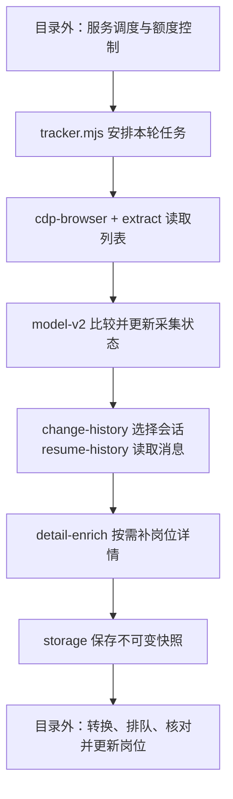

# BOSS 采集器：文件职责与阅读导览

本目录负责**从 BOSS 读取资料，整理并保存本机采集材料**。岗位的正式更新由目录外的服务完成。

完整当前流程与业务规则见 [BOSS 主文档](../../docs/BOSS_AUTOMATION_DESIGN.md#数据链路)；本文维护采集器的文件职责、调用关系与阅读顺序。

核对日期：2026-10-12；代码基线：`68187539`，应用 `0.10.21`。目录共有 **19 个实现文件、17 个测试文件、3 份说明文档**。以下介绍现有实现，后续建议见[重构清单](../../docs/ARCHITECTURE_REFACTOR_PLAN.md)。

## 先理解主链路

`tracker.mjs` 是入口，负责把其他文件串起来。一轮正常采集的主要步骤如下；图中表示执行步骤，省略了辅助依赖。



历史读取与详情之间还有可选的 `dom-supplement.mjs` 页面补采，生产默认关闭。运行状态、检查点和部分历史证据会在过程中保存，图中的最终快照不是唯一保存时机。

三个结果分别记录：**已经读到材料、已经交给服务、已经更新岗位**。采集快照中的“岗位资料”属于来源材料，不是工作台正式岗位记录。

## 文件职责

### 1. 主入口

| 文件                       | 负责什么                                                                                                     | 主要关系                                                                                                     |
| -------------------------- | ------------------------------------------------------------------------------------------------------------ | ------------------------------------------------------------------------------------------------------------ |
| [tracker.mjs](tracker.mjs) | 解析命令参数；安排列表、历史、页面补采和详情阶段；选择补录目标，汇总用量、故障和本机状态；保存快照与导出清单 | 调用下面各组模块。`run` 执行控制层分配的一轮任务，自身不安装周期调度；补录与正常历史的部分外围编排仍各自存在 |

建议先看 `main` 的 `run` 分支，再按调用进入具体文件。

### 2. 浏览器连接与读取

| 文件                               | 负责什么                                                                                                                             | 主要关系                                                                                                                                             |
| ---------------------------------- | ------------------------------------------------------------------------------------------------------------------------------------ | ---------------------------------------------------------------------------------------------------------------------------------------------------- |
| [cdp-browser.mjs](cdp-browser.mjs) | 通过 Chrome 调试协议连接专用浏览器；绑定、核验任务页，执行固定读取表达式；等待列表就绪；提供受控详情标签的创建、导航、读取和清理能力 | `tracker` 调用 `start / resume / capture / evaluateBound`；`detail-enrich` 通过它提供的详情页面操作函数（adapter）读取页面                           |
| [guard.mjs](guard.mjs)             | 提供预期聊天网址与网址检查；保留旧原生标签观察、文本读取及诊断辅助函数                                                               | 当前主流程使用 `expectedUrl / isExpectedUrl`；账号及浏览器实例的完整核验由 `cdp-browser` 配合 `extract` 完成。其余旧原生辅助函数未发现当前运行调用者 |
| [paths.mjs](paths.mjs)             | 计算私有数据根目录、账号目录和浏览器 profile 路径，校验账号标签与路径输入                                                            | `tracker / export-jobs` 使用账号目录；`cdp-browser` 使用 profile 目录。实际写文件由存储模块负责                                                      |

`start` 和显式 `recover-page` 可以按既有规则建立任务页。日常读取复用绑定的浏览器实例与任务页，账号或目标变化时停止；不能由正常轮次随意重建页面。

### 3. 列表与消息

| 文件                                             | 负责什么                                                                                                                            | 主要关系                                                                                                                                |
| ------------------------------------------------ | ----------------------------------------------------------------------------------------------------------------------------------- | --------------------------------------------------------------------------------------------------------------------------------------- |
| [extract.mjs](extract.mjs)                       | 定义账号与列表读取脚本；读取已加载 Vue 列表数据，补充已渲染行的时间/回执；转换为标准列表快照，计算账号隔离标识（namespace）与会话键 | 由 `cdp-browser` 执行，结果交给 `tracker / model-v2`；回执解析复用 `receipt`                                                            |
| [receipt.mjs](receipt.mjs)                       | 从可见标签和样式解析消息的 `read / delivered / unknown`，并汇总数量                                                                 | 被 `extract` 的页面脚本及 `tracker` 汇总调用；只表示消息回执，不判断简历是否发送                                                        |
| [change-history.mjs](change-history.mjs)         | 根据最新消息 ID、摘要和岗位 ID 的变化安排历史任务；计算待执行任务、成功消息位置、分页进度及失败等待                                 | 是纯状态计算，不发请求、不写文件。`tracker / history-commit` 调用它，`runtime-state` 保存结果                                           |
| [resume-history.mjs](resume-history.mjs)         | 生成联系人/历史分页的只读请求脚本；串行读取消息，限制请求与页数；转换、去重并合并简历观察及无法识别的原因                           | `tracker` 两种历史入口共用 `runResumeHistoryRequests`；`history-commit / dom-supplement` 复用观察转换。消息含义来自目录外的共用简历规则 |
| [platform-reference.mjs](platform-reference.mjs) | 保存已核实的公开平台版本参考；读取当前已加载脚本 URL，判断新的不透明动作扩展是否适用；提供显式字节指纹比较函数                      | `tracker` 在实际历史读取前调用，再把契约传给 `resume-history`。URL 匹配不证明本轮源码字节相同；它不自动下载源码                         |
| [dom-supplement.mjs](dom-supplement.mjs)         | 在特定历史读取不足时，从聊天页面补读白名单系统状态；管理独立的人工验收策略、轮转进度和切换检查点                                    | 由 `tracker` 可选调用，转换复用 `resume-history`。须有账号绑定验收策略和明确零未读依据；生产默认关闭，选择器仍待人工验收                |

**这里的区别：** `change-history` 决定读谁，`resume-history` 执行历史读取，`receipt` 解释列表回执。[简历发送含义](../../docs/BOSS_AUTOMATION_DESIGN.md#简历规则的维护)和[岗位归属](../../docs/BOSS_AUTOMATION_DESIGN.md#归属判断)仍需各自核对，`strong` 只是采集侧的分类标签，不能代替服务应用判定。

### 4. 采集数据与岗位资料

| 文件                                   | 负责什么                                                                                                                                       | 主要关系                                                                                                              |
| -------------------------------------- | ---------------------------------------------------------------------------------------------------------------------------------------------- | --------------------------------------------------------------------------------------------------------------------- |
| [model-v2.mjs](model-v2.mjs)           | 校验和升级采集数据；比较当前列表与旧快照；维护长期会话、岗位关联、资料证据、候选与已有确认；迁移旧资料；并入详情结果，生成岗位解析行和待补目标 | 当前 `tracker` 使用的采集模型；依赖 `job-evidence` 及目录外的链接、标题和证据格式校验规则。它不提交工作台正式岗位     |
| [job-evidence.mjs](job-evidence.mjs)   | 在已选会话关联上匹配岗位 ID/规范链接，排序资料证据、核对矛盾及确认记录，返回选用资料与来源                                                     | 被 `model-v2` 和目录外 `scripts/boss-conversion.mjs` 共用；显式保留采集展示、详情交付、旧身份映射三种用途的差异       |
| [detail-enrich.mjs](detail-enrich.mjs) | 分组待补岗位，复用已有证据；通过传入的页面操作函数串行读取稳定的详情标题，取得岗位名/用人公司及独立观察时间，返回完成与失败结果                | 页面操作由 `cdp-browser` 提供，结果由 `model-v2.applyDetailEvidenceV2` 并入采集模型；范围、延迟和外层额度由调用者传入 |
| [compare.mjs](compare.mjs)             | 校验并比较旧 v1 列表状态，维护旧格式的差异与记录                                                                                               | 用于旧导出兼容及测试；当前平台身份主链路使用 `model-v2.compareLoadedSnapshotsV2`                                      |
| [job.mjs](job.mjs)                     | 旧格式岗位候选的规范化、选择及数量汇总                                                                                                         | `tracker` 用 `jobCounts` 汇总 v1 状态；候选选择函数当前主要由旧格式测试使用，不是现行详情证据判断入口                 |

`model-v2.mjs` 中的 **v2 是历史文件名**，当前正常升级/写入的采集容器是 **v8**；它与工作台共享数据版本是两件事。当前版本表见[数据与恢复](../../docs/DATA_AND_RECOVERY.md#版本与两种存储模式)。

详情的用人公司可以与聊天中的招聘方不同；精确岗位身份一致时，这个名称差异不单独构成冲突。详情证据选择与工作台的普通资料应用仍是两个步骤，具体规则见[岗位资料与平台状态](../../docs/BOSS_AUTOMATION_DESIGN.md#岗位资料与平台状态)。

### 5. 保存、恢复与导出

| 文件                                     | 负责什么                                                                                                      | 主要关系                                                                                                                  |
| ---------------------------------------- | ------------------------------------------------------------------------------------------------------------- | ------------------------------------------------------------------------------------------------------------------------- |
| [storage.mjs](storage.mjs)               | 读取最近采集快照；保存/移除连接元数据；建立账号采集锁；先保存诊断，再以临时文件替换保存不可变快照             | 由 `tracker` 调用；保存的是私有采集材料，不是正式工作区提交                                                               |
| [runtime-state.mjs](runtime-state.mjs)   | 校验、读写本机运行状态和两类历史检查点；保存补录/详情游标、历史任务、详情失败等待、CDP 有限重连及最近轮次结果 | `tracker / history-commit` 使用；历史逻辑状态复用 `change-history`。不负责服务跟踪授权或滚动小时预算                      |
| [history-commit.mjs](history-commit.mjs) | 协调变化驱动历史的恢复与提交：先保存材料，再保存任务进度，最后移除检查点                                      | 通过注入的保存函数和 `runtime-state` 操作；复用 `change-history / resume-history`。当前未统一覆盖公平补录、详情或页面补采 |
| [export-jobs.mjs](export-jobs.mjs)       | 把采集模型整理成私有 `jobs.md` 清单，安全写入 Markdown；兼容旧采集格式                                        | 当前格式通过 `model-v2` 解析岗位，与 `status` 共用解析结果；旧格式分支使用 `compare`                                      |

`tracker.saveEnvelope` 先保存 JSON，再导出 Markdown。导出失败时，已保存的快照保留，可继续本机恢复。

页面补采有独立的状态保存流程。当前代码先记录完成、移除其检查点，再返回材料给 tracker 后续保存，存在待验证的中断顺序风险；这不表示已证实真实材料丢失。不能把 `history-commit` 的顺序保证推广到全部阶段。

## 容易混淆的文件

| 两者                                           | 区别                                                   |
| ---------------------------------------------- | ------------------------------------------------------ |
| `change-history` / `resume-history`            | 前者选择和推进历史任务；后者真正读取历史、整理观察     |
| `history-commit` / `runtime-state` / `storage` | 分别负责提交顺序、运行进度及检查点文件、快照及连接文件 |
| `detail-enrich` / `job-evidence` / `model-v2`  | 分别负责取得详情材料、选择适用资料、将材料并入采集状态 |
| `compare` / `model-v2`                         | 旧 v1 比较与兼容；当前基于平台身份的模型及比较         |
| 本目录 `runtime-state` / 外部 `boss-runtime`   | 采集进度、重试和游标；跟踪生命周期、调度和持久预算     |
| 本目录 `storage` / 外部 `workspace-store`      | 私有采集快照；工作台正式记录的唯一提交者               |

## 与目录外代码的关系

```text
scripts/boss-controller + boss-runtime
    ↓ 明确授权、串行轮次、额度与单次票据
scripts/boss-integration
    ↓ 调用固定 tracker，持有生产者锁
collector/boss/tracker
    ↓ 保存采集快照
scripts/boss-integration + boss-conversion + boss-inbox
    ↓ 转换成确定性批次，诊断、入队并记录交付进度
scripts/workspace-consumer + workspace-store
    ↓ 按当前工作区重新判断并保存正式结果，之后确认回执
工作台页面读取正式状态；GitHub 由用户手动同步
```

共用规则也在目录外：

- [`dist/resume-rules.js`](../../dist/resume-rules.js)：简历观察分类、明确含义与状态转换依据。
- [`dist/boss-attribution.js`](../../dist/boss-attribution.js)：归属证据校验与判定。
- [`dist/boss-job-url.js`](../../dist/boss-job-url.js)、[`dist/boss-detail-title.js`](../../dist/boss-detail-title.js)：岗位 ID/规范链接及详情标题解析。
- [`dist/boss-job-materials.js`](../../dist/boss-job-materials.js)：根据当前正式岗位和绑定判断普通资料是否可应用。

这些规则可以被采集或转换复用。正式消费仍会重验含义、归属、人工字段和冲突，采集端通过格式校验不代表岗位一定更新。

## 测试文件

以下均为合成数据、模拟执行器或临时目录测试。即使文件名包含 `cdp-browser` 或 DOM，也不代表测试启动真实浏览器；真实验收由用户负责。

| 测试文件                                                   | 主要检查什么                                                                          |
| ---------------------------------------------------------- | ------------------------------------------------------------------------------------- |
| [tracker.test.mjs](tracker.test.mjs)                       | 参数、目标选择和汇总；两种历史入口、请求用量、检查点恢复、平台版本检查及保存/导出失败 |
| [cdp-browser.test.mjs](cdp-browser.test.mjs)               | 绑定与任务页复用、列表就绪等待、账号/浏览器/目标变化、受控详情标签操作                |
| [extract.test.mjs](extract.test.mjs)                       | 已加载列表、稳定会话身份、回执和覆盖统计，异常字段与页面结构                          |
| [receipt.test.mjs](receipt.test.mjs)                       | 已读/送达标签与样式匹配；缺失、隐藏或矛盾保持未知                                     |
| [change-history.test.mjs](change-history.test.mjs)         | 初始化与变化排队、旧任务指纹、失败等待/隔离和其他任务继续                             |
| [resume-history.test.mjs](resume-history.test.mjs)         | 只读请求、消息分类和身份、分页/用量/检查点、版本门槛、稳定观察和脱敏                  |
| [history-commit.test.mjs](history-commit.test.mjs)         | 保存材料、进度、移除检查点各阶段失败；仅有未支持原因及目标变化时的恢复                |
| [dom-supplement.test.mjs](dom-supplement.test.mjs)         | 人工策略、零未读、预算、独立来源、切换未知不重试及私有状态保存                        |
| [platform-reference.test.mjs](platform-reference.test.mjs) | 公开脚本 URL/版本匹配、账号检查、只读元数据及显式字节指纹                             |
| [model-v2.test.mjs](model-v2.test.mjs)                     | 会话/岗位关联、旧格式迁移、资料证据、候选/确认、详情合并及容器校验                    |
| [detail-enrich.test.mjs](detail-enrich.test.mjs)           | 标题稳定、详情证据复用、资料提取、失败范围和自有标签清理                              |
| [job.test.mjs](job.test.mjs)                               | 旧岗位候选的规范化、选择与数量                                                        |
| [job-review.test.mjs](job-review.test.mjs)                 | 旧 v1 链接确认的校验、持久保留和精确作用范围                                          |
| [compare.test.mjs](compare.test.mjs)                       | 旧格式列表差异、缺项/重复、消息/回执/岗位变化和无效数据                               |
| [runtime-state.test.mjs](runtime-state.test.mjs)           | 轮转、退避/隔离、有限重连、私有检查点、版本门槛及旧状态兼容                           |
| [storage.test.mjs](storage.test.mjs)                       | 不可变快照、采集锁、连接元数据、权限与异常保存                                        |
| [export-jobs.test.mjs](export-jobs.test.mjs)               | 当前/旧格式清单输出、候选与回执展示、私有 Markdown 写入                               |

`guard.mjs`、`paths.mjs`、`job-evidence.mjs` 没有同目录的同名测试文件；不能据文件名直接判断功能是否有间接测试。`job-evidence` 的跨层对照测试在 [`test/boss-job-evidence.test.mjs`](../../test/boss-job-evidence.test.mjs)，覆盖三种用途、各类批次和稳定身份；模型、详情与转换测试也会使用该规则。

## 三份说明文档

| 文档                           | 用途                                           |
| ------------------------------ | ---------------------------------------------- |
| [README.md](README.md)         | 当前文件职责、调用关系和阅读顺序，即本文       |
| [AGENTS.md](AGENTS.md)         | 代理执行采集、排障时的只读、授权和操作边界     |
| [SAVE_RULES.md](SAVE_RULES.md) | 采集字段、身份、保存和隐私要求，含历史演进规则 |

运行入口、当前流程与业务规则、预算及故障处理统一见 [BOSS 主文档](../../docs/BOSS_AUTOMATION_DESIGN.md)；目录外的系统职责见[系统架构](../../docs/ARCHITECTURE.md)，格式兼容与恢复见[数据与恢复](../../docs/DATA_AND_RECOVERY.md)，决定来源及历史演进见[决策索引与 ADR](../../docs/DECISIONS.md)。

## 建议阅读顺序

1. `tracker.mjs`：先找到 `main` 和 `run` 分支，理解整轮步骤。
2. `extract.mjs`：看页面数据怎样变成列表快照。
3. `model-v2.mjs`：看列表快照怎样保留会话和岗位关联。
4. `change-history.mjs → resume-history.mjs`：看如何选择聊天、分页读取消息。
5. `history-commit.mjs → runtime-state.mjs → storage.mjs`：看成功进度与材料怎样保存和恢复。
6. `detail-enrich.mjs → job-evidence.mjs → model-v2.applyDetailEvidenceV2`：看岗位资料的取得、选择和合并。
7. 最后看 `cdp-browser.mjs` 的底层连接及相应测试，再追目录外的转换与正式消费。

操作仍从仓库根目录使用 `pnpm boss ...` 统一入口，完整命令见[BOSS 接入设计](../../docs/BOSS_AUTOMATION_DESIGN.md#运行与入口)。服务启动不授权或恢复 BOSS 跟踪。本目录源码公开，实际资料、profile、连接与进度默认保存在忽略的 `.local/boss-collector/`，不应混入源码目录。
