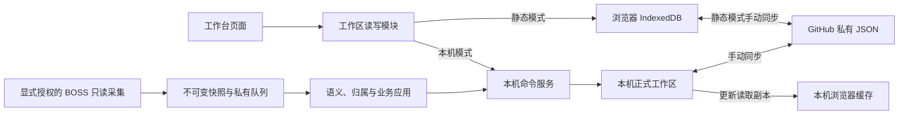
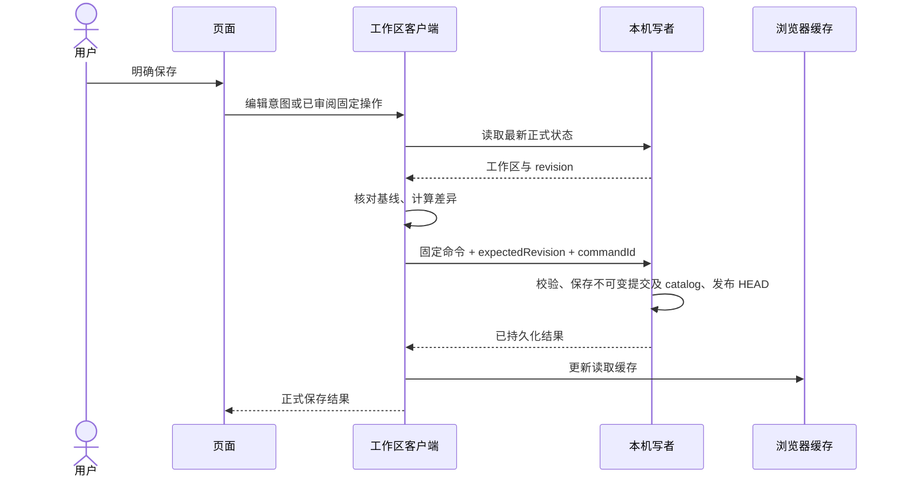
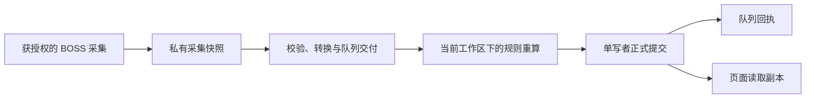

# 当前系统架构

本文描述当前实现：运行结构、模块职责、数据所有者与关键流程。核对日期为 2026-10-31，应用为 0.11.0、BOSS 规则为 v17；当前格式版本以[数据与恢复](DATA_AND_RECOVERY.md#版本与两种存储模式)为准。历史决定及替代关系保留在 [ADR 索引](adr/README.md)，0.10.23 的职责调整见[架构重构记录](ARCHITECTURE_REFACTOR_PLAN.md)。

## 阅读入口

| 要了解的内容                       | 对应文档                                                |
| ---------------------------------- | ------------------------------------------------------- |
| 术语及事实与判断的区别             | [CONTEXT.md](../CONTEXT.md)                             |
| 当前结构、职责和数据流             | 本文                                                    |
| 采集授权与只读边界                 | [自动化规约](AUTOMATION_POLICY.md)                      |
| BOSS 当前流程、业务规则与预算      | [BOSS 设计说明](boss/DESIGN.md)                         |
| BOSS 模块、字段与交付机制          | [BOSS 实现说明](boss/IMPLEMENTATION.md)                 |
| BOSS 命令、状态与排障              | [BOSS 操作说明](boss/OPERATIONS.md)                     |
| 格式迁移、正式提交、同步与恢复细则 | [数据与恢复](DATA_AND_RECOVERY.md)                      |
| 启动、发布、排障与人工验收         | [维护手册](MAINTENANCE.md)                              |
| 历史原因与版本变更                 | [决策索引](adr/README.md)、[CHANGELOG](../CHANGELOG.md) |

## 运行方式

源码层级和静态依赖可通过独立的 `pnpm uml` 桌面工具浏览，使用与边界见[维护手册](MAINTENANCE.md#独立-uml-源码浏览器)。它只读取公开源码，运行依赖与生成图留在 `.local/uml-viewer/`，不属于应用运行链路或网页部署内容。

界面使用静态 HTML/CSS/ES modules；`dist/` 是直接维护的公开源码，也是唯一公开部署目录，没有构建阶段。Node 24 运行本机服务和采集子进程，pnpm 与依赖版本由 `package.json` 和锁文件固定。运行代码没有第三方包依赖，Prettier 和 Playwright 用于开发检查。

| 模式          | 正式数据由谁保存                                   | 浏览器的角色                                               | 服务不可用时                                 |
| ------------- | -------------------------------------------------- | ---------------------------------------------------------- | -------------------------------------------- |
| 本机模式      | Node 服务在 `.local/workspace/` 保存唯一正式工作区 | IndexedDB 是读取缓存，页面通过固定命令保存；草稿留在浏览器 | 读取已有缓存、保留草稿；正式写入等待服务恢复 |
| 静态/手机模式 | 当前浏览器的 IndexedDB                             | IndexedDB 事务保存正式记录，草稿另存 localStorage          | 不依赖本机工作区服务                         |

两种模式通过用户明确发起的 GitHub 同步交换共享数据。已采用本机模式后，连接失败不能自动改为静态写入；已有不同缓存或工作区身份时，先备份并明确切换。首次迁移及身份保护见 [D026](adr/0026-local-authoritative-workspace.md) 与[数据与恢复](DATA_AND_RECOVERY.md#首次迁移与版本保护)。

图中的工作区与 GitHub 连线表示同步结果关系，实际传输由 REST 或本机 SSH adapter 完成。BOSS 采集器与工作台服务使用独立进程；服务启动可处理已有本机材料，不能授权平台访问或恢复此前跟踪。

## 模块职责

### 五个职责组

| 职责组          | 当前主要模块                                                                                             | 对调用者提供的能力                                   |
| --------------- | -------------------------------------------------------------------------------------------------------- | ---------------------------------------------------- |
| 页面交互        | `app.js`、`app-startup.js`、`views.js`、`settings-view.js`、`ui.js`、`text-input.js`                     | 启动、渲染、表单、导航、输入与操作反馈               |
| 共用业务规则    | `model.js`、`jobs.js`、`today.js`、`daily.js`、`planning.js`、BOSS 规则模块                              | 校验、查询、合并、业务含义、归属和应用结果           |
| BOSS 采集与交付 | `collector/boss/`、`scripts/boss/control/`、`scripts/boss/delivery/`                                     | 显式调度、预算、取材、进度保存、确定性批次及入队     |
| 工作区存储      | `storage.js`、`local-workspace.js`、`workspace-api.mjs`、`workspace-store.mjs`、`workspace-consumer.mjs` | 模式路由、固定命令、单写者提交、幂等、队列消费与回执 |
| 同步与恢复      | `github.js`、`local-ssh.js`、`ssh-store.mjs`、`workspace.js`、备份和草稿模块                             | 手动同步、备份、恢复、冲突核对与草稿准备             |

表中浏览器 `.js` 位于 `dist/`，服务 `.mjs` 位于 `scripts/`。BOSS 模块按职责分目录；共享工作区、同步与备份仍位于各自原有层。测试保持原位置，模块目录不设置汇总所有能力的总入口。

### 规则与适配的实际位置

| 事项               | 唯一规则或主要实现                                                                          | 调用者与保留条件                                                                 |
| ------------------ | ------------------------------------------------------------------------------------------- | -------------------------------------------------------------------------------- |
| 岗位查询与行动建议 | `jobs.js`、`today.js`、`daily.js`、`planning.js`                                            | 页面与详情共用纯查询；日期查询展示当前岗位信息，不推断历史阶段                   |
| 简历语义与状态转换 | `boss/rules/resume-rules.js`；联动规则在 `model.js`                                         | 采集、转换、应用与展示共用；识别结果不授予归属或人工字段所有权                   |
| 岗位资料证据       | `boss/rules/job-evidence.js`、`boss/contracts/detail-title.js`、`boss/contracts/job-url.js` | 采集展示、详情交付和旧身份映射共用；三种用途的兼容语义分别保留                   |
| 普通资料应用判断   | `boss/application/job-materials.js`                                                         | 完整与缺标题观察、当前重评及恢复共用纯判断；原始观察不改写                       |
| 归属判断           | `boss/rules/attribution.js`                                                                 | 对各完整观察独立核对；上下文按当前材料构建，候选不等于已确认归属                 |
| 批次与来源身份     | `boss/contracts/batch-format.js`、`boss/rules/batch.js`、`source-identity.js`               | 校验与稳定 ID 共用；旧事件身份不随规则升级改写                                   |
| 应用与人工决定     | `boss/application/integration.js`、`boss/application/observations.js`、`source-ledger.js`   | 正式消费和固定人工命令执行规则；事实与应用决定分别保存                           |
| 本机命令交付       | `local-workspace.js`                                                                        | 普通编辑与固定操作共用串行、revision、精确重试及缓存更新                         |
| 历史阶段与提交     | `collector/boss/history/history-phase.mjs`、`history-commit.mjs`                            | 共用带平台游标的历史读取与恢复；变化任务逐条提交，公平补录在快照与导出成功后结算 |
| 服务启动与身份     | `service-control.mjs`、`service-runtime.mjs`、`serve.mjs`                                   | 共用健康检查；`doctor.mjs` 读取已验证结果，不另行猜测身份                        |

BOSS 的目录边界如下：

| 目录                             | 职责                                             |
| -------------------------------- | ------------------------------------------------ |
| `collector/boss/platform/`       | 浏览器连接、任务页和账号核验、平台字段与版本读取 |
| `collector/boss/history/`        | 历史策略、共用读取与结算、可选 DOM 补采          |
| `collector/boss/details/`        | 详情阶段安排与受控页面读取                       |
| `collector/boss/materials/`      | 采集模型、证据采用、旧格式兼容与清单输出         |
| `collector/boss/persistence/`    | 私有快照、运行进度、检查点与纯本机恢复           |
| `dist/boss/contracts/`、`rules/` | 格式、岗位身份、简历含义、归属及证据选择规则     |
| `dist/boss/application/`         | 按传入工作区计算业务应用、人工决定及观察展示数据 |
| `dist/boss/client.js`            | 浏览器发现服务、队列状态与工作区连接适配         |
| `scripts/boss/control/`          | 显式授权、生命周期、预算和单次票据               |
| `scripts/boss/delivery/`         | 已保存材料校验、转换、入队和交付检查点           |
| `scripts/boss/shared/`           | 固定源码及私有路径、脱敏诊断                     |

`collectHistory / settleSaved`、`collectDetails` 和 `deliverSaved / recoverSaved` 分别收敛历史、详情和本机交付。依赖边界见下节；Node 服务复用 application。`batch-validation.mjs` 用 Node 哈希核验批次，不操作文件；`inbox.mjs` 负责队列保存。`shared/paths.mjs` 以源码仓库为根计算 CLI、采集器及私有路径，不依赖调用时的工作目录。`app.js` 仍编排岗位编辑、详情导航及手动同步。

### 依赖与写入约束

- 页面调用渲染、纯规则与工作区 interface；本机正式修改经 `storage.js` / `local-workspace.js` 交付，不直接写磁盘、操作 Git 或改写来源账本。
- 纯规则处理传入数据并返回结果；DOM、网络、文件和进程操作放在相应 adapter。浏览器加载的模块及其全部传递依赖须位于可公开部署的 `dist/`，不能依赖 Node 内置模块或外部包。
- 采集适配器负责真实平台字段与请求，归属及业务判断使用共用规则；controller 负责生命周期和编排，不能自行解释卡片含义。
- `WorkspaceStore` 是本机正式写者；消费器和 HTTP 命令都经它提交。队列、采集进度、正式数据和浏览器缓存各自维护，不能以某一层的完成状态代替另一层确认。

BOSS 基础 contracts/rules 的传递依赖仅限 contracts/rules 和纯叶 `dist/source-identity.js`，不引入 application、client、共享 model/storage 或界面模块；application 可以使用 model。采集器不能导入 control/delivery，只允许共用 Node 诊断叶模块；Node 服务及其传递依赖不能导入浏览器 client。

[生产依赖检查器](../scripts/module-check.mjs) 静态解析 dist、scripts、collector 的公开 `.js/.mjs`，检查文件存在、大小写、目录及父路径符号链接、循环和依赖层级，不链接或执行模块。扫描排除测试、私有材料、依赖及第三方技能；旧采集目录的 data/profile 等私有材料按路径排除，不排除其他公开目录中的同名源码。动态 import、require、importScripts、Worker、eval 和 Function 写法被保守拒绝；词法检测不能覆盖任意计算、间接别名或运行时生成代码，静态依赖合法不证明运行行为纯净。命令入口见[维护检查](MAINTENANCE.md#每次改动)。

## 数据所有者

| 数据或材料                 | 负责维护它的模块                              | 用途与约束                                                                 |
| -------------------------- | --------------------------------------------- | -------------------------------------------------------------------------- |
| 岗位、任务、沟通、导入记录 | 业务规则计算；本机服务或静态事务保存          | 面向用户的正式结果，包含人工字段与删除标记                                 |
| `sourceBindings`           | 来源绑定及字段所有权规则                      | 账号/岗位关联、自动字段和 last-auto；人工清空也受保护                      |
| `sourceEvents`             | BOSS 批次应用                                 | 原始观察及兼容历史映射；展示按当前应用决定解释，纠错不改写原始材料         |
| `sourceFacts`              | 共用来源身份与账本                            | 稳定事实身份；同一事实可有多个完整观察候选，存在不代表已经应用             |
| `sourceApplications`       | 业务应用及固定人工命令                        | 应用状态、原因、规则版本、人工忽略/否决/资料处理决定                       |
| `data`、`base`、`pending`  | 工作区、同步与恢复规则                        | 当前数据、最后确认的云端基线、未解决冲突及其双方；`base` 不是备份          |
| 不可变提交、HEAD、catalog  | `workspace-store.mjs`                         | 正式 revision、持久命令定位和唯一原子根；不能手工改写                      |
| 采集快照与检查点           | `collector/boss/`                             | 真实观察与采集进度，私有保存，恢复不能补造缺失身份                         |
| 队列与回执                 | `scripts/boss/delivery/inbox.mjs`；消费器确认 | 交付材料及提交后的处理记录；回执不证明恢复后事实仍在                       |
| 草稿                       | `draft-data.js`、`drafts.js`                  | 浏览器 localStorage 的允许字段与不可变版本；不是正式记录，不保存设置或 PAT |
| 浏览器缓存与旧快照         | `storage.js`                                  | 本机模式下是副本；浏览器旧快照不等于服务提交历史                           |
| 独立磁盘备份               | `disk-backup.js`、`disk-backups.mjs`          | 完整工作区与草稿的私有副本，独立于 SSH 和浏览器清理                        |

正常导入只推进满足规则的自动字段，不回退新状态、不复活删除。人工忽略和否决按来源事实持续保留；该会话的新消息独立处理。已应用历史的人工纠错需要明确审阅的清单与固定命令，不属于自动全量回退。

## 数据流

### 1. 页面保存

普通编辑在同一串行任务中读取最新数据并计算差异，无变化不生成命令。固定操作核对用户已审阅的 revision。响应丢失只重发同一 commandId、revision 和 payload；版本冲突刷新后需要重新核对，不自动重算重放。旧命令结果先读取当前正式工作区再更新缓存，缓存失败不把已确认保存改为失败。

静态模式改用 IndexedDB 最新状态及事务保存。删除标记、人工字段、表单原始基线和中文输入保护仍有效；跨标签通知后保留另一页面草稿。普通编辑与后台导入对同步冲突采用各自准入规则：本机独立编辑可重基，受影响的岗位与依赖仍停止，不能合并成一条全局放行规则。

### 2. BOSS 导入

BOSS 以显式授权的采集子进程取得材料，经私有队列交给本机服务；服务依据当前工作区重算规则，再由唯一写者提交。采集、交付、正式应用及回执分别确认，页面读取正式结果。

已有材料可以只在本机补交和消费；服务重启不恢复 BOSS 跟踪，GitHub 继续由用户手动同步。正常/恢复分支、采集范围、日期与业务准入见 [BOSS 完整流程](boss/DESIGN.md#完整流程)，模块与交接见[实现说明](boss/IMPLEMENTATION.md#模块与调用顺序)，使用及恢复见[操作说明](boss/OPERATIONS.md)。

正常采集和独立历史补录的最终保存共用 `history-phase.saveHistoryCapture`，将材料、运行进度与检查点结算顺序保留在一处。定点维护复用既有授权、预算、锁和交付实现，入口见[维护复用表](boss/IMPLEMENTATION.md#定点维护复用入口)；排障先核对已有平台契约与本机材料，避免另写请求和保存协议。

消费在途进度只保存在进程内，通过现有 BOSS 状态入口读取，不形成持久索引或业务事实；页面忙时读取该内存视图，完成后刷新完整正式状态。显式消费请求等待本轮之后的一次合并扫描，后台定时扫描不持续追加；只读队列检查在 revision 稳定时才返回，恢复仍核对当前事实及人工决定。

### 3. GitHub 手动同步

1. 用户发起同步，准备已有本机状态和同步前保护；页面协调同源同步锁。
2. REST 或 SSH adapter 读取配置目标；工作区按 `base / local / remote` 三方合并。未知、损坏或未来格式停止，已有云端文件消失不能当空数据覆盖。
3. 有冲突时保存双方及 pending，用户逐项核对后一次保存；无冲突时校验最终序列化 UTF-8 大小，再上传计划快照。
4. 上传结果确认后更新同步基线。上传期间的新编辑按实际上传快照重基，继续保持待同步；不能将它们误标为已上传。

本机 SSH 由服务在真实读取时签发一次性事务，绑定正式 revision、远端 SHA 和计划；上传前服务再次核对，成功后以事务 ID 确认。网页不能自报 remote、captured 或 uploaded 整库绕过权威检查。静态 REST 使用相应浏览器事务，PAT 只在页面内存；两种传输共用合并与上传确认规则。首次创建先核对私有仓库、分支与配置 JSON 路径。见 [D004](adr/0004-local-ssh-session-token.md)、[D005](adr/0005-three-way-merge-conflicts.md) 与[数据与恢复](DATA_AND_RECOVERY.md)。

### 4. 备份与恢复

1. 页面读取完整工作区与允许的草稿，下载 JSON 或写入独立私有磁盘备份；同步基线、pending 双方及本机草稿都保留。
2. 恢复先解析、迁移和预检备份，准备整批草稿副本，再按用户选择执行合并恢复或回到快照。准备失败不能先改正式工作区。
3. 本机恢复经固定命令追加新正式编辑；静态恢复经 IndexedDB 事务。操作前快照创建失败中止配套编辑，普通恢复保留当前云端基线；回到快照对省略记录保留删除标记。
4. 正式恢复失败回滚本批准备的草稿副本；正式恢复成功后完成草稿导入。草稿与正式数据处于不同介质，不能描述为跨介质原子事务。

当前已有 pending 时先解决它再恢复；含 pending 的完整备份只允许回到快照，并保留备份的同步目标与冲突双方。恢复同一事实时保留已有人工资料处理与语义否决，缺失或删除材料不补造、不复活。旧回执或旧命令不能代替事实存在性检查。详细恢复与迁移条件见 [DATA_AND_RECOVERY.md](DATA_AND_RECOVERY.md#两种恢复)。

## 页面状态与生命周期

`app-startup.js` 只标识工作区及首屏的 starting、ready 或 failed，不解释后台采集结果。`app.js` 管理视图、筛选、页码、详情与来源位置，`views.js` 等负责渲染；`jobs / today / daily / planning` 负责纯查询和建议。默认进入行动今天；刷新不恢复浏览会话，详情与查询结果独立。

打开、关闭、编辑或恢复草稿后保持筛选与来源位置；结果减少时收敛页码，关闭详情恢复滚动和焦点。渲染保留展开状态及未提交输入，不能替换中文组合输入控件。下一步建议只是可编辑预填，任务仍须明确保存。原始表单基线与草稿版本用于并发核对，清理只删除已提交的精确版本，清理失败不把正式保存变为失败。

本机页面目前约每 30 秒读取 BOSS 接入状态；页面可见且服务管理消费时，约每 15 秒读取正式工作区。焦点及可见状态变化也可刷新。它们更新缓存和展示，不启动平台采集；后台消费由服务独立运行。间隔不是完成时限，服务短暂失联时保留最近状态并标记待更新。具体交互与故障验收见[BOSS 人工验收](boss/OPERATIONS.md#人工验收)及[恢复与迁移验收](DATA_AND_RECOVERY.md#恢复与迁移验收)。

## 持久化、隐私与外部接口

本机写者保存不可变完整提交及 catalog，完成文件与目录持久化后，原子 HEAD 同时绑定两者。正常启动完整校验当前提交和 catalog，旧命令按需读取原提交，完整历史审计显式执行；catalog 损坏或未知格式停止写入，不能用空索引重新执行业务命令。HEAD 可见而目录持久化未确认时，不能确认提交或回执。见 [D041](adr/0041-workspace-startup-catalog.md) 与[本机不可变提交](DATA_AND_RECOVERY.md#本机不可变提交)。

公开仓库仅含源码、文档与合成测试。真实数据、原始快照、简历、下载备份、浏览器草稿和全部 `.local/` 为私有；不得加入 `dist/`、采集源码或测试 fixture。服务只监听回环地址，校验 Host/Origin、随机会话与版本化协议。SSH 使用系统密钥和独立 bare 缓存，只写固定 JSON 路径，不操作用户的 Obsidian 工作树、不强推；PAT 只在页面内存。

同步限额与完整备份限额由 `limits.js` 共用，上传前校验最终 UTF-8 字节。REST 按元数据给出的 blob SHA 读取大文件；SSH 输出先收集字节再严格解码。独立备份与 SSH 分开，各来源保留每日首份与最新一份，目录 0700、文件 0600，拒绝符号链接；浏览器清理不会删除磁盘备份。验证失败或超限时仍保留紧急原始导出。数值和操作步骤见[数据与恢复](DATA_AND_RECOVERY.md)及[维护手册](MAINTENANCE.md)。

## 维护与重构

改动前按[现状与目标核对](agents/change-workflow.md)追踪实际调用者；新业务规则放入对应共用模块，测试预期从原始要求独立确定。规则、应用决定、持久化交付及页面反馈各自核对，成功计数或回执不能代替结果验证。

本次 BOSS 职责重构已完成，范围及历史依据见[重构记录](ARCHITECTURE_REFACTOR_PLAN.md)。生产依赖的检查范围与限制见[依赖与写入约束](#依赖与写入约束)，执行入口见[维护检查](MAINTENANCE.md#每次改动)。后续改动继续保留稳定身份、业务结果、人工保护、冲突与恢复语义；发布前运行完整 `pnpm test`、`pnpm check` 和 `pnpm format:check`。浏览器及真实平台验收由用户完成，服务更新不自动恢复跟踪或同步 GitHub。
