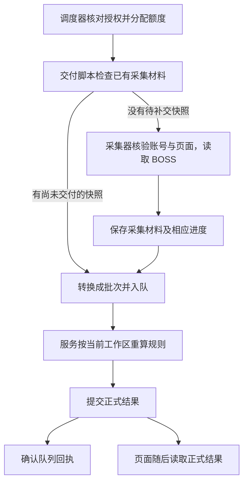
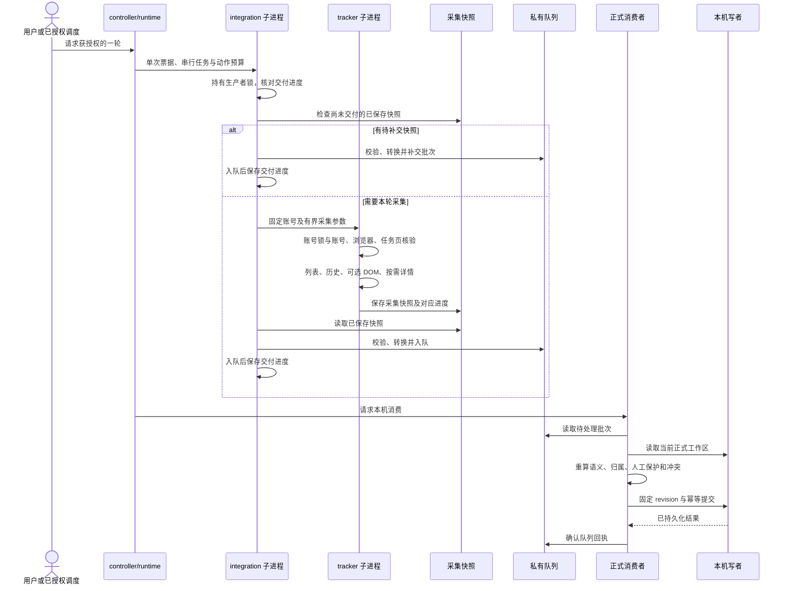

# BOSS 只读采集与岗位更新：流程和规则

更新日期：2026-10-12；职责核对基线：`68187539e26899042a4add76b10b5bec9a8a18fb`，实现版本 v0.10.22。本页是 BOSS 当前流程与业务规则的主文档，集中说明运行入口、采集与交付、归属、简历联动、岗位资料、动作预算和阶段故障；授权及操作边界见 [AUTOMATION_POLICY](AUTOMATION_POLICY.md)。脚本、协议和合成数据测试不等于真实环境验收，验收分工见 [维护手册](MAINTENANCE.md#真实浏览器测试分工)。

当前运行方式依据 [D026](adr/0026-local-authoritative-workspace.md) 和 [D028](adr/0028-change-driven-history.md)；业务收敛与后续调整见 [决策索引](DECISIONS.md)。首批规则保留于 [D023](adr/0023-boss-private-queue-integration.md) 和 [D024](adr/0024-boss-date-label-import.md)，旧版关页积压、仅手动单轮、45 分钟/每天 16 次等运行限制已由 D026 替代。

## 从这里阅读

| 想了解什么                         | 本页位置                                                         |
| ---------------------------------- | ---------------------------------------------------------------- |
| 服务和跟踪怎样启动、停止           | [运行与入口](#运行与入口)                                        |
| 一轮采集怎样到达正式结果           | [数据链路](#数据链路)                                            |
| 怎样判断消息归属和简历状态         | [身份、字段与业务规则](#身份字段与业务规则)                      |
| 岗位资料、人工状态和等待项怎么处理 | [岗位资料](#岗位资料与平台状态)、[应用结果](#应用结果与页面核对) |
| 请求次数怎样限制                   | [频率与实际动作预算](#频率与实际动作预算)                        |
| 失败后怎样暂停、保留材料和恢复     | [事务、并发与故障](#事务并发与故障)                              |

当前规则在本页集中维护。其他文档分别负责系统结构、操作边界、存储恢复和历史理由，职责见[文档分工](#文档分工)。待实施的代码调整见[重构清单](ARCHITECTURE_REFACTOR_PLAN.md)。

## 运行与入口

本机服务和 BOSS 跟踪是两个独立生命周期。服务仅监听回环地址，启动后读取本机工作区、处理已授权的本地队列；只有用户明确开始跟踪后，服务内部才按间隔运行平台采集。服务重启后不恢复跟踪授权，预算、检查点和暂停诊断保留。没有登录自启、系统定时任务或自动 GitHub 同步。

| 命令                                            | 作用                                                                      |
| ----------------------------------------------- | ------------------------------------------------------------------------- |
| `pnpm service start/status/stop`                | 启动、只读查询或安全停止本项目服务；停止前校验实例身份，不按陌生 PID 强杀 |
| `pnpm boss start`                               | 校验工作区与固定采集配置，建立/复用任务页，开始持续跟踪                   |
| `pnpm boss run` / `pnpm boss check`             | 请求单轮采集；同一轮在执行时复用结果，不堆积补跑                          |
| `pnpm boss backfill`                            | 单轮公平历史回填，保留旧游标；完成后默认仍为变化驱动                      |
| `pnpm boss pause` / `resume`                    | 停止后续采集或在原因排除并校验后恢复；不清空预算                          |
| `pnpm boss resume-details`                      | 只解除详情所有权技术阻断；不访问浏览器、不改变账号生命周期或清空岗位退避  |
| `pnpm boss stop`                                | 等待在途轮次结束并停止跟踪，不关闭用户原 BOSS 标签                        |
| `pnpm boss recover-page`                        | 仅停止/暂停状态下显式恢复任务页；不自动刷新原标签                         |
| `pnpm boss recover-saved`                       | 纯本地补交已保存快照并消费队列；保持停止，不访问 BOSS 或占平台额度        |
| `pnpm boss status` / `doctor`                   | 查看跟踪生命周期、预算、服务状态与诊断                                    |
| `pnpm boss preview/enqueue`                     | 兼容首批快照的本地预览与授权入队                                          |
| `pnpm boss enqueue-yesterday --date YYYY-MM-DD` | 兼容用户明确确认日期的标签补录，不从当前日期猜测                          |
| `pnpm boss enqueue-resume`                      | 兼容已保存快照的简历观察入队                                              |

采集器源码固定在仓库 `collector/boss/`，账号标签及固定历史快照由私有配置指定；网页不能传任意脚本、路径或平台请求，旧 `trackerRoot` 配置不再决定执行位置。连接使用直接 CDP 与已核验账号的任务专用后台标签，日常连接与读取不要求把用户 BOSS 标签选到前台。任务自建详情标签记录所有权，清理前重新核验；断开客户端保留 Chrome 登录会话，停止跟踪不关闭用户标签。

生命周期命令按调用顺序串行；`start`、`resume`、`recover-page` 在操作 CDP 前等待调用前已开始的轮次收尾，`pause/stop` 的持久状态优先于晚到轮次结果。电脑休眠或进程停止期间不运行，恢复后不补跑漏过的轮次。

## 数据链路

这一节描述**已获授权的一轮采集与本机处理**。可以先按下面的步骤理解；下方再对应实际模块。

图中“读取 BOSS”按列表、历史消息、可选页面补采、岗位详情的顺序执行，阶段是否运行受任务、额度与失败结果影响。历史消息通过任务页内已验证的只读请求取得。页面补采生产默认关闭，岗位详情只对符合条件的目标补齐；一轮不保证读取所有聊天或岗位。

有已保存但尚未交付的快照时，本轮先在本机补交这些材料，不再额外采集 BOSS。提交后的页面读取由页面刷新或轮询触发；页面关闭后，服务仍可处理本机队列。

### 当前采集模块与状态所有者

| 部分       | 当前模块                                                          | 具体负责什么                                                                                             |
| ---------- | ----------------------------------------------------------------- | -------------------------------------------------------------------------------------------------------- |
| 授权与调度 | `scripts/boss-controller.mjs`、`scripts/boss-runtime.mjs`         | 决定是否运行、串行执行、预留和结算额度，签发本轮单次票据；账号与任务页的现场核验由采集器执行。           |
| 采集       | `collector/boss/tracker.mjs` 及其读取模块                         | 核验账号、浏览器与任务页面，读取列表、消息和按需详情，保存采集材料与进度。                               |
| 材料交付   | `scripts/boss-integration.mjs`、转换模块、`boss-inbox.mjs`        | **在采集前后都参与**：先补交已有快照，必要时调用采集器；采集返回后再校验快照、转换、入队并保存交付进度。 |
| 正式处理   | `scripts/workspace-consumer.mjs`、共用规则、`workspace-store.mjs` | 根据当前工作区重算语义、归属、人工保护和冲突，由唯一写者提交，成功后确认回执。                           |

**采集快照与队列是两份用途不同的材料：** 快照保存采集得到的资料，队列保存交给服务处理的标准批次。采集器保存快照，交付脚本负责入队。材料中的初步识别或归属判定仍需在正式消费时重新核对；正式结果也可以是等待、保护或没有业务变化。

#### 实际模块调用顺序

上图展示的是成功交付路径。网页不参与队列消费；服务也可以独立消费和重试本机队列，平台采集仍受原授权与暂停规则约束。账号初始化、任务页建立、暂停和恢复等生命周期步骤见[运行与入口](#运行与入口)。

这些状态分别用于授权与额度控制、取材恢复、材料交付和正式业务提交，不能由一个完成标记代替。变化驱动历史已由 `history-commit.mjs` 集中执行“保存证据 → 保存进度 → 移除检查点”；该职责当前没有统一覆盖回填、DOM 和详情。DOM 当前在返回观察前保存任务完成状态并移除检查点，观察由 tracker 后续保存，因此不能宣称它已满足相同提交顺序；生产策略仍默认禁用。

变化驱动历史与手动回填已经共用 `runResumeHistoryRequests`、消息解析及共用简历规则。历史上下文的恢复、前后身份守卫和平台版本读取仍在两条编排中重复；独立详情命令与整轮采集仍分别编排选择、读取、应用、退避和游标提交。普通轮次与 `recover-saved` 的交付及本机消费结果整理也尚未集中。后续职责收敛见[架构重构清单](ARCHITECTURE_REFACTOR_PLAN.md)；其中新代码阶段均未实施，不改变本文所列当前所有者和操作边界。

### 列表、历史与详情从哪里来

- **聊天列表：** 读取任务页已经加载的列表数据，主要来自页面状态；可见行的时间、已读或送达标签可由页面元素补充，离屏状态不猜测。不自动滚动加载全部会话。
- **历史消息：** 在已绑定任务页内先取得联系人信息，再使用已验证的只读请求分页读取消息。程序保存必要观察和暂不支持的原因。
- **岗位详情：** 先复用已有详情依据，仍缺岗位名称的合格目标再由任务自己的后台详情标签读取标题，补齐岗位和用人公司信息。
- **页面补采：** 这是独立的可选读取方式，生产默认关闭；启用条件和未读保护见[动作预算](#频率与实际动作预算)。

### 变化驱动与手动回填

`start/run/check` 默认按消息 ID、摘要哈希和岗位 ID 的列表指纹排队；排序、时间标签和普通已读变化不触发历史请求。首次初始化仅为当前已加载、具有上海当天具体时分或“昨天”标签的会话建立任务，其余建立比较基线，之后发生指纹变化才排队。列表不自动滚动加载全部历史，未出现在列表不表示删除。

会话任务保存指纹、成功消息水位和下一页；遇到水位或历史末尾停止，普通消息 ID 也可构成成功水位，没有简历事实也算完成历史检查。已检查且无变化时历史请求为零。每页先写私有证据检查点，快照持久化后才推进任务。覆盖截断、分页未完成、故障退避和技术隔离分别显示，不作为业务人工核对项。

`pnpm boss backfill` 显式执行单轮公平历史回填，保留旧游标，与变化驱动共用账号锁、预算、证据和正式录入；完成后不改变持续跟踪模式。一轮有界回填不保证覆盖全部旧消息。检查点恢复顺序见 [本机不可变提交](DATA_AND_RECOVERY.md#本机不可变提交)，历史选择与首次初始化依据见 [D028](adr/0028-change-driven-history.md)。

### 交付、正式消费与日期

用户命令由 `boss-control.mjs` 或本机控制 API 进入 controller/runtime，已授权的定时轮次也由 runtime 调度。需要新采集时，交付脚本调用 tracker，形成两层子进程；纯本机补交使用已保存材料。runtime 持久保存生命周期与动作预留/结算，controller 先核对正式工作区再签发单次票据。tracker 维护采集任务、水位、游标、退避和连接；integration 核对快照及摘要，入队后保存交付检查点和来源序号。生产者暂停、交付进度和跟踪授权分别管理。

正式消费使用当前来源记录与可准入材料构建上下文，重算语义、归属、人工保护和冲突，由 `workspace-store` 唯一提交，成功后确认回执。诊断或关键保存失败不确认配套交付；同批顺序或重复采集不改变稳定原因。恢复后仍须核对事实存在性，回执不能代替此项检查。正式存储、事务和恢复契约见[数据与恢复](DATA_AND_RECOVERY.md#本机不可变提交)。

增量与补录共用联系人/消息读取、转换与业务规则，差异限于任务选择与扫描范围；旧首批及指定日期规则在兼容模块中保留。明确 `HH:mm` 的增量日期由原快照 `capturedAt` 的上海日期确定；延迟交付不改为执行当天，其他不可靠日期不猜测。列表外详情只补充原关联岗位资料，不凭新快照创建新日期证据。

## 频率与实际动作预算

以下是本工具的本机限制，不是平台公布的安全阈值，也不能保证不触发风控。旧 45 分钟/每日 16 次尝试限制由实际动作预算替代。

| 动作                           | 当前默认规则                                                               |
| ------------------------------ | -------------------------------------------------------------------------- |
| 持续跟踪列表检查               | 上一轮结束 2 分钟后开始下一轮，仅当前已加载会话；不导航、刷新或自动滚动    |
| 本地预览、校验、入队和正式录入 | 不占平台动作预算                                                           |
| 手动重复检查                   | 每账号串行，在途触发复用同一轮；普通 `run/check` 保留 10 秒防抖            |
| 历史相关只读请求               | 每轮最多 20 次、滚动 60 分钟最多 60 次；联系人请求和每页历史请求分别计一次 |
| 受控 DOM 会话切换              | 每轮最多 1 次、相邻切换至少 30 秒；生产默认禁用，须完成私有页面验收        |
| 岗位详情导航                   | 每轮最多 20 个；相邻导航至少 10 秒                                         |
| DOM 切换与详情导航合计         | 共用滚动 60 分钟最多 60 次额度                                             |

历史请求串行发送，默认相邻请求等待 3 秒。额度按滚动 60 分钟内持久记录的动作数计算，不按整点重置；详情优先分配可用导航额度，DOM 只能使用剩余额度。预算不足跳过相应补齐阶段并保留进度，不能通过暂停、重启、重复命令、账号标签或兼容脚本绕过。

平台轮次开始前先持久化本轮可用上限作为保守预留，预留时间为轮次开始时间。可信结构化结果返回后用实际用量替换预留，按本轮结束时间计入滚动窗口；可正常返回的失败也按结束时间结算，缺失或损坏用量保守使用预留上限。进程崩溃未完成结算时，保留开始时间的预留。重启、暂停或恢复均不清零，额度随对应记录超过滚动窗口释放。

可确认尚未发出平台动作的本地预览、校验、断链失败和队列处理不占额度；已经发出但失败或结果未知的动作仍计数。历史请求在页面内 15 秒主动超时，CDP 外层 20 秒停止等待；结果未知时不重放同一请求，保存页码并等待下轮继续。每轮还必须原子消费控制器签发、绑定精确历史/DOM/详情额度及历史模式的短时单次票据，旧脚本不能绕过统一调度。

DOM 额度只表示受控补采上限。生产策略默认关闭，只有用户验收私有页面样本，确认唯一目标行、会话身份、稳定消息 ID/时间及 `unreadMsgCount === 0` 保护后，才允许启用。补采仅读取已识别会话的最小状态证据，不扫描完整聊天正文；会话切换若会改变平台未读状态，停止该方式。

## 身份、字段与业务规则

正式应用按观察类型核对含义、岗位归属、资料和人工保护。下面直接说明当前规则；来源账本、同步冲突与恢复契约见[数据与恢复](DATA_AND_RECOVERY.md#来源事实应用与冲突)，术语见 [CONTEXT](../CONTEXT.md)。

### 归属判断

账号 namespace 与稳定工作区身份先绑定；会话核对联系人、响应身份与消息参与者，岗位按账号内 ID 和规范链接关联。姓名、同名公司、单行返回和唯一候选本身都不能证明归属。

核对本机岗位链接时先使用共用解析器去除查询参数和片段，再比较规范链接；用户保存的原链接保留。参数差异不单独构成岗位身份冲突，无效域名、路径或不同岗位仍拦截。

`boss-attribution.js` 对每个完整候选独立判断，冲突优先；不把不同观察缺失的字段拼为已验证依据。消息有明确岗位身份时核对一致性，没有时按 [D035](adr/0035-boss-conversation-association-application.md) 允许完整会话关联依据；当前联系人岗位不能证明全部历史按岗位隔离。跨岗位重复消息与会话岗位变化继续按 [D034](adr/0034-boss-cross-observation-attribution.md) 拦截；人工否决的原始观察仍参与异常上下文。

### 简历规则的维护

当前识别规则包含明确系统文字、严格动作结构，以及下节 D049 对已核实版本不透明扩展的补充；旧材料不因升级取得新的可信地位。

`resume-rules.js` 是简历观察枚举、业务含义和转换的唯一规则定义。精确文案“附件简历请求已发送”保持已发送含义；旧 `request_sent` / `resume_request_sent` 是兼容标识，不按名称重新解释。通用卡片模板、泛化关键词、送达或已读不能单独证明发送。

服务对所有有业务目标的简历观察重算批次携带的最小 `resumeEvidence` 后再判断归属和字段所有权，语义与归属须在同一观察内完整；旧材料缺可核对状态依据时等待，不因兼容版本取得可信地位。v2 依据额外携带最小结构判别字段，严格识别链接消息中的附件发送确认及类型 4 中的查看系统确认，不能全面放开普通类型 4 卡片；固定字段与精确文案的边界见 [D047](adr/0047-boss-explicit-system-confirmations.md)。v3 依据补充已核实的 `type=1 / body.type=4 / body.templateId=1 / body.action.aid=40` 动作确认，只接受缺省或明确非作品集的扩展判别；系统发送文案由该动作生成，普通 type 1 聊天或引用文字、旧 v1/v2 type 1 依据均不足。八个白名单字段及扩展边界见 [D048](adr/0048-boss-action-resume-confirmation.md)。两个 `target === null` 的纯卡片观察在不足或已验证时存档为 `no_effect / observation_only`，正式目标为空；明确冲突仍 review，缺稳定消息身份仍作为采集问题处理。依据不保存正文、简历或凭据，附件名使用固定占位；诊断只保留必要字段存在情况、身份摘要、阶段和判定。

满足条件的自动发送/接收通过 `model.js` 的联动规则推进已读和沟通中；人工字段、较高阶段及对方已接收的状态不回退。明确清单的语义纠错将符合条件的自动已发送改为未知，并撤回仍由该误判维护且无人工活动的自动沟通中，消息已读保持；恢复只保护已经完成的阶段纠正，不扩大旧的仅简历纠正决定。完整边界见 [D031](adr/0031-explicit-resume-semantics.md)、[D043](adr/0043-boss-observation-only-archive.md)、[D044](adr/0044-boss-card-semantics-evidence.md)、[D045](adr/0045-boss-reviewed-resume-semantics-correction.md)、[D046](adr/0046-boss-resume-correction-linked-stage.md)。

### 平台转换版本与不透明扩展（0.10.21，D049）

共用简历分类返回已识别、无关、暂不支持；历史读取和兼容表达式显式注入自包含分类器，服务消费重验同观察内的结构与归属。严格 action40 的不透明字符串仅在已核实转换契约下形成 v4 依据，不能把所有解析失败作为发送。相关未支持动作进入现有 unresolved，消息读取进度不等于业务应用成功。

平台参考模块拥有已核实公开 app/chat URL、build、asset 和原始 SHA。实际历史读取前复用账号及绑定目标守卫，只读取已加载脚本 URL；无目标不增加版本读取，完成检查点回放不增加历史请求或公开脚本版本读取，既有账号预检保持。known 才允许不透明分支，changed/unavailable 不影响既有 JSON、文字和查看确认。完整源码在忽略目录，URL 匹配 basis=reviewed_url / contentVerified=false；同 URL 内容变化需显式字节比较。新版本必须重新核对，不自动下载、执行或调整规则。

定点交付在事件映射前按本轮观察 ID 筛选，缺省转换保持原输出；完整真实快照、原事件身份和批次摘要算法保留。共享格式不变，私有版本和恢复门槛见[数据与恢复](DATA_AND_RECOVERY.md)，来源与取舍见 [D049](adr/0049-boss-versioned-opaque-action-evidence.md)。

当前已核实转换版本为 `v5550 / 4d4a6ac8`。检查复用采集前后的账号及原绑定目标守卫，只读取已加载脚本 URL，不启用调试器或增加平台请求；普通聊天和作品集不会形成发送或故障。

### 岗位资料与平台状态

`job-evidence.mjs` 在已选会话关联上核对岗位 ID、规范链接、证据排序及确认记录。详情名称和用人公司优先于聊天列表，招聘方可以不同；详情证据必须属于同一岗位，多份证据或身份矛盾继续拦截。匿名用人公司原样保留，缺字段可用精确且唯一的有效本机绑定补齐，不能猜公司。旧身份映射的文字比较、排序和缺省值保持，避免改动历史 ID。

`boss-job-materials.js` 的 `assessBossJobMaterials({ event, accountNamespace, opportunities, bindings })` 统一普通资料的当前工作区判断，返回判定、目标与绑定、字段资料来源、有效应用输入及允许更新字段。完整观察、缺标题观察、waiting/review 重评与恢复共用它。复用本机资料时，账号、岗位 ID、规范链接与唯一未删除目标须一致；招聘方与用人公司名称不同不单独拦截，聊天公司不能覆盖已保存的用人公司。无详情的非空标题与已有岗位名矛盾时，即使仍有自动所有权也需核对；一致的详情仍可更新自动资料。缺标题可复用完整且精确一致的本机资料，记录 `no_effect / bound_job_details_available` 或 `existing_job_details_available`，不补写原始观察、不取得自动字段所有权；身份、详情的真实矛盾及旧非空标题的 review 材料继续核对。

平台 `unknown / open / closed` 与个人招聘阶段独立。关闭不自动结束跟进、删除或忽略观察；页面读取失败不证明关闭。人工资料确认只结束允许的普通资料问题，不确认简历含义或归属。见 [D038](adr/0038-boss-job-details-and-observation-groups.md)、[D039](adr/0039-boss-manual-retired-job-resolution.md)。

### 应用结果与页面核对

`waiting` 表示仍缺资料或证据，`review` 表示需要核对的真实矛盾，`protected` 表示人工字段或决定已保留，`applied / no_effect` 分别记录生效与没有业务变化。同账号、会话、稳定消息的多类观察汇总展示，事实与应用仍分别保存；候选岗位始终标为候选。

用户可查看候选、明确编辑岗位、通过受限命令确认普通资料，或多选有效等待项后确认忽略。编辑岗位不确认旧观察归属，也不自动忽略观察；人工忽略退出等待但持续保留原事实，同一事实补录不能恢复应用。不存在通用确认归属或清空 review 的入口。已有材料可经本机周期消费重评，不新增异常驱动的平台请求。见 [D036](adr/0036-boss-waiting-observation-ignore.md)、[D042](adr/0042-data-sync-guided-resolution.md)。

## 事务、并发与故障

工作区单写者、固定 API、版本比较、持久幂等、提交后回执、同步事务及恢复缺口规则见 [数据与恢复的本机不可变提交](DATA_AND_RECOVERY.md#本机不可变提交) 和 [来源事实、应用与冲突](DATA_AND_RECOVERY.md#来源事实应用与冲突)。当前启动校验和按需历史审计范围按 [D041](adr/0041-workspace-startup-catalog.md) 执行。

队列坏批次隔离并保留诊断；已知账号失败时暂停该账号的后续依赖，其他账号可继续处理，不能跳过账号内失败顺序强行录入。

登录、验证码、账号/目标/主任务页或页面结构异常立即暂停账号；普通暂时故障连续三轮后暂停。`pause` 停止后续调度，已开始动作安全收尾；`stop` 等待在途轮次结束。已保存阶段仍可交付，部分成功报告 `partial`，保留完成与剩余项。任务页失效须显式核验后使用 `recover-page`，不能循环刷新、重建或自动登录。

从 0.10.9 起，主列表尚未挂载的 `LOADED_LIST_NOT_READY` 先在本次绑定、恢复或采集操作内等待就绪：同一操作共享最多 10 秒、最多 20 次间隔 500 毫秒的只读等待，每次等待后重新核验同一浏览器实例、任务目标及网址。10 秒限制就绪等待，单次 CDP/HTTP 读取仍受原有超时约束，操作总耗时可能更长。列表就绪仍核对账号；其他身份或页面错误立即失败，等待耗尽仍保留原码并按现有规则暂停。这个窗口只读取同一页面，不刷新、导航、切换、创建页面或发出历史请求，不恢复旧授权或改变平台动作预算。错误仅说明程序未找到可读取的列表数据，不能单凭该码认定平台结构变化、登录失效或网络失败。

无平台请求副作用的 CDP 调试通道传输中断，按持久的 2、10、30 秒最多三次重连；计数和下一次时间跨轮次保留。已发出且结果未知的历史请求按一次保守计数，重连不重放；带创建、导航、切换或关闭副作用的命令也不自动重放。任务页、浏览器实例、URL、登录或账号身份异常不属于传输重试。

单个详情标签丢失、网址变化、导航或读取超时只形成 `failureScope=detail`，停止当轮详情批次，不累计账号级连续失败；列表、历史和本地正式录入继续。详情所有权不一致额外阻断详情阶段，只有显式 `resume-details` 解除，岗位退避及隔离仍保留。详情岗位失败依次等待 30 分钟、2 小时、24 小时，第四次实际失败进入本机技术隔离；退避/隔离项让出公平游标，成功补齐清除该岗位重试状态。变化驱动历史任务也保留分页、退避和隔离状态；它们不等于业务等待或人工核对。

`recover-saved` 等待在途轮次结束，核对已保存快照与检查点并消费本地队列，保持停止，不访问平台或占平台额度。只有本地快照/检查点类暂停在完整恢复后可清除；登录、验证码、账号和任务页类暂停仍须走 `resume/recover-page`。完整检查点恢复、工作区备份恢复和来源缺口处理见 [数据与恢复](DATA_AND_RECOVERY.md)，操作排障见 [维护手册](MAINTENANCE.md#排障)。磁盘队列回执不能证明恢复后的当前工作区仍包含对应事实。

私有 `.local/boss-integration/` 保存 inbox、receipts、runs、incidents、control 和 tracking 状态；`.local/boss-collector/` 保存采集器原始快照、连接、运行材料和 Chrome profile。目录 `0700`、文件 `0600`。诊断只保存必要的运行/批次 ID、阶段、错误码、时间、账号哈希、覆盖数量、最后成功快照、完成/剩余项和清理结果；归属诊断仅保存摘要及字段存在情况。先持久化诊断再安全清理，诊断保存失败不确认配套进度或交付，未解决故障材料不自动删除。终端只输出统计、错误和路径；私有材料边界见 [操作规约](AUTOMATION_POLICY.md#故障暂停与恢复) 和 [归属诊断](DATA_AND_RECOVERY.md#v090-归属依据与本机诊断)。

诊断须分别报告服务状态、跟踪状态和暂停原因。沙箱或容器返回 `SERVICE_UNAVAILABLE` 可能仅表示该执行上下文无法访问宿主机回环端口；宿主机终端的 `pnpm service status` / `pnpm boss status` 才提供实时结果，磁盘状态表示最后持久化结果。判断步骤见 [维护手册的排障](MAINTENANCE.md#排障)。

本机岗位 Markdown 清单与采集、交付采用同一个规范链接和岗位 ID 校验，支持 `~`；导出失败保留先前已保存的 JSON 快照，非编码异常转为固定 `JOB_EXPORT_FAILED`，已有安全错误码保留，不输出原始异常文字。历史请求用量在后续证据、进度或导出保存失败时仍保留；旧检查点纯本机恢复不增加请求用量。快照、正式录入和清单导出结果分别确认，部分成功不等同于整轮完成。

详情任务、公平轮转、岗位游标、指定岗位参数及历史消息的岗位字段共用同一岗位 ID 校验；其他联系人、账号和消息 ID 保留各自规则。已完成检查点的零请求恢复只豁免当前任务，后续任务仍须具备足够请求额度，不能借旧检查点绕过预算。失败时仅回传已保存的最新历史进度，服务普通部分失败也接收这个既有摘要；纯本机恢复成功不证明重新访问平台。

## 升级与验收

升级、备份、首次迁移、服务重启及人工验收按 [维护手册](MAINTENANCE.md#发布) 和 [数据与恢复](DATA_AND_RECOVERY.md#恢复与迁移验收) 执行。普通采集、入队和录入无需改代码、重启服务或刷新；服务代码/配置升级后重新明确开始跟踪。当前版本的详情采集及本地交付验收见 [0.10.5 维护记录](MAINTENANCE.md#0105-详情采集错误修复)。真实浏览器验收由用户完成，未确认时仍记为待人工验收。

## 兼容入口与历史授权

本节保留版本演进和当次授权的范围，供维护或恢复时核对。当前判断使用前面的[业务规则](#身份字段与业务规则)；一次授权不成为持续采集许可，记录中的验收状态保持原样。

### 识别规则升级与旧材料

精确平台文案与状态转换以 [`dist/resume-rules.js`](../dist/resume-rules.js) 为唯一规则定义，维护方法见 [当前简历规则](#简历规则的维护)，用户确认样例见 [D025](adr/0025-controlled-conversation-detail-read.md)。通用卡片模板不能证明简历发送；0.10.15 的语义依据与旧材料边界见 [D044](adr/0044-boss-card-semantics-evidence.md)。规则含义、归属和应用条件分别见 [D030](adr/0030-reject-misattributed-resume-observation.md)、[D031](adr/0031-explicit-resume-semantics.md) 和 [D035](adr/0035-boss-conversation-association-application.md)；本机消息/阶段联动见 [当前简历联动](#简历规则的维护)。

0.10.18 按 [D047](adr/0047-boss-explicit-system-confirmations.md) 补读已核实的链接发送文字，并严格识别类型 4 中的明确查看系统消息；普通卡片与引用文字仍不联动。新证据保存最小判别字段，所有业务简历观察共用消费重验，不新增平台请求或自动补录。列表指纹没有变化的已完成历史不会因此主动重新读取；用户确认的定点记录可通过既有人工编辑修正，旧卡片不会凭升级变成确认事实。

0.10.20 按 [D048](adr/0048-boss-action-resume-confirmation.md) 补读动作生成的发送确认：严格核对 `type=1 / body.type=4 / body.templateId=1 / body.action.aid=40` 与缺省或非作品集扩展判别，再产生固定状态文案。普通 type 1 聊天或引用、作品集、未知 `annexType` 值或无效扩展不确认，旧 v1/v2 type 1 依据不提升。私有快照/批次 v7、历史检查点 v5 支持八字段 v3 动作依据，服务消费重验；共享数据和正式存储格式不变，语义识别不放宽归属或人工所有权。

### 当次授权的现存岗位补状态

用户于 2026-10-10 要求仅补当日现存岗位的自动状态。本次临时补查复用已识别会话、`runResumeHistoryRequests`、持久预算及账号锁，按有限页数串行读取，保存不可变快照，经既有简历批次队列和正式服务消费交付。任务不新建岗位，不运行普通增量建档或详情补齐；缺唯一现存目标、归属不足或受人工、删除、冲突保护的观察保留对应结果，不强行应用。

这是当次授权范围，不新增 CLI、页面入口或长期配置，也不启动持续跟踪或自动 GitHub 同步。执行前后保留私有备份，分别核对覆盖、截断、已保存观察、正式应用和保护项；实际补入数量与真实覆盖待执行后确认，有限扫描不能保证所有旧消息已覆盖。操作及人工验收见 [维护手册](MAINTENANCE.md#动作型发送确认与受限补状态01020d048)。

### 已授权历史日期

首批固定快照、日期及纳入范围见 [D023](adr/0023-boss-private-queue-integration.md)；“昨天”标签的明确日期补录见 [D024](adr/0024-boss-date-label-import.md)。首批规则不复用于持续跟踪，现行增量日期和延迟入库规则见 [本页的交付与日期规则](#交付正式消费与日期)，兼容命令操作及历史验收见 [维护手册](MAINTENANCE.md#排障)。

### 0.10.21 当次定点核实

本轮定点核实复用持久 runtime 与一次性内部票据，最多 4 个历史请求（含联系人），详情与会话操作为 0，保留每小时限制。旧服务必须完全退出，临时执行器才能拥有同一预算文件；只执行单轮，不 start/resume 持续跟踪。原始响应只在内存转换，脱敏字段依据保存成功后才确认本机进度，复用该响应交付本轮目标观察。正式服务启动前预演全队列的业务变化，具体操作见[维护说明](MAINTENANCE.md)。

## 不透明动作扩展与转换版本（0.10.21，D049）

当前规则已集中到[平台转换版本与不透明扩展](#平台转换版本与不透明扩展01021d049)；当次定点核实范围见[历史授权记录](#01021-当次定点核实)。

## 文档分工

| 文档                                      | 维护的内容                                         |
| ----------------------------------------- | -------------------------------------------------- |
| 本文                                      | BOSS 当前采集、交付、业务规则、预算和阶段故障      |
| [系统架构](ARCHITECTURE.md)               | 两种运行模式、模块职责、数据所有者及跨系统流程     |
| [操作规约](AUTOMATION_POLICY.md)          | 招聘平台授权、只读动作、串行执行和隐私边界         |
| [数据与恢复](DATA_AND_RECOVERY.md)        | 正式写入、格式兼容、迁移、同步冲突、备份与恢复保护 |
| [维护手册](MAINTENANCE.md)                | 实际操作、排障、升级回退及各版本执行和验收记录     |
| [采集器导览](../collector/boss/README.md) | 采集源码文件职责与建议阅读顺序                     |
| [领域词汇](../CONTEXT.md)                 | 术语；不承担实现或当前规则说明                     |
| [决策索引与 ADR](DECISIONS.md)            | 决定发生时的来源、理由、取舍和替代关系             |

修改当前 BOSS 行为说明时先更新本页，再按实际影响更新专题契约和引用；ADR 保留原始历史。文档整理不改变规则、格式或平台授权，也不表示待实施重构已完成。
