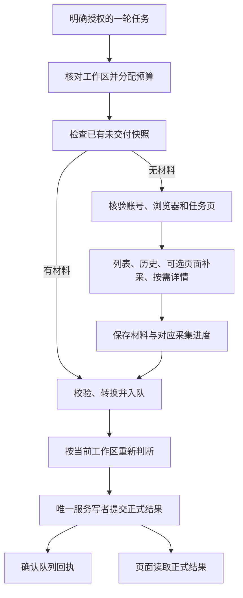

# BOSS 只读采集与岗位更新：设计说明

本文说明系统当前怎样工作：读什么、如何判断、什么时候更新岗位，以及没有完成时保留什么结果。代码实现见[实现说明](IMPLEMENTATION.md)，日常命令和排障见[使用与排障](OPERATIONS.md)。

核对日期：2026-10-31，应用 0.11.0、BOSS 应用规则 v17。本文描述现行行为；0.10.23 的职责调整见[重构记录](../ARCHITECTURE_REFACTOR_PLAN.md)。决定理由和替代关系见[全项目 ADR 索引](../adr/README.md)。

## 目标与范围

BOSS 接入把用户已授权读取的平台资料保存到本机，再按当前工作区判断是否改变岗位。平台只读：不回复、打招呼、投递、发送消息或简历，也不自动处理登录、验证码。授权与隐私的共用边界在[自动化规约](../AUTOMATION_POLICY.md)维护。

本机服务和平台跟踪独立。启动服务只允许本机工作区和已授权队列处理；明确开始跟踪后才按间隔访问 BOSS。服务重启后跟踪保持停止，预算与恢复材料保留。网页关闭不影响已授权的本机处理；GitHub 仍由用户手动同步。

## 核心对象

| 对象             | 表示什么                         | 与其他对象的关系                                             |
| ---------------- | -------------------------------- | ------------------------------------------------------------ |
| 账号             | 一份已核验的平台账号身份         | 隔离会话、消息、岗位绑定及预算；本机账号标签不是身份凭证     |
| 会话             | 账号内由平台联系人身份确定的聊天 | 通过关联记录连接岗位；同会话换岗保留旧关联                   |
| 岗位机会         | 工作台中跟进的具体职位           | 同公司不同职位各自独立，一个职位可有多个招聘联系人           |
| 观察             | 一次取得的列表、消息或详情材料   | 各自保留来源和身份依据，不因被采到就成为业务确认             |
| 来源事实         | 具有稳定身份的一项平台事实       | 同一事实可有多份观察；普通消息、回执和简历确认是不同事实类型 |
| 来源应用         | 对事实是否作用于岗位的决定       | 与原始观察分开保存，可等待、冲突、保护、生效或无变化         |
| 快照、批次、回执 | 采集材料、交付材料、批次处理记录 | 分别证明保存、交付和处理，任何一个都不能替代另外两个         |

完整术语见[领域词汇](../../CONTEXT.md)。候选岗位表示程序找到的可能目标，尚未满足条件时不显示为已确认归属。

新滚动采集材料会省略连续相同列表岗位资料的中间观测，保留首末原证据、所有资料变化及并列时间材料；已有原始快照保持。此规则减少空转增长，不改变岗位、简历或归属判断，技术边界见[滚动快照的重复证据与大小](IMPLEMENTATION.md#滚动快照的重复证据与大小)及 [D050](../adr/0050-boss-bounded-snapshot-evidence.md)。

## 完整流程

| 步骤       | 输入与条件                                           | 结果及例外                                                                   |
| ---------- | ---------------------------------------------------- | ---------------------------------------------------------------------------- |
| 安排任务   | 用户单轮命令或仍有效的跟踪授权；工作区就绪，账号串行 | 分配有界预算。休眠、停机期间不采集，恢复后不补跑错过的轮次                   |
| 选择材料   | 先检查已保存且尚未交付的快照                         | 有材料时先纯本机补交，本轮不再新增平台采集                                   |
| 平台读取   | 核验同一浏览器实例、任务页、网址和账号               | 按阶段读取；身份失效停止。采到部分材料不等于全部聊天已覆盖                   |
| 保存与交付 | 采集快照通过版本、字段及安全校验                     | 保存不可变快照，转换为稳定批次，入队后记交付进度；关键保存失败不确认配套进度 |
| 正式判断   | 当前工作区、未删除来源观察与整个批次                 | 重新判断资料、语义、归属、人工保护和局部同步冲突，不信任生产者的“已验证”标签 |
| 正式提交   | 候选结果和预期工作区版本仍一致                       | 单写者原子提交，之后确认回执。恢复后仍检查事实是否存在，不能只看旧回执       |
| 展示       | 页面读取正式工作区与本机状态                         | 可显示岗位更新、等待、核对、保护或纯存档；页面不负责消费队列                 |

增量与历史回填共用历史阶段的身份检查、读取、实际请求计量和检查点恢复；任务选择、扫描范围与完成结算仍按各自策略执行。正常轮次与单独补查共用详情阶段。首批、日期、简历、增量及恢复共用已保存材料的交付顺序，保留各自的转换与日期规则；正式应用继续按当前工作区重验。

## 采集规则

### 任务页与读取范围

- 明确 `start` 可启动专用 Chrome 用户目录，建立或复用任务页；缺页时最多创建或导航一次。停止或暂停后明确 `recover-page` 才能恢复失效任务页。
- 日常连接与读取只复用已保存的浏览器实例和任务目标，不刷新、重建、激活或关闭沟通页，也不要求用户将任务页置于前台。用户原有标签不作为可随意操作的对象。
- 列表读取任务页已加载的页面状态，可见行补充时间及回执；不自动滚动加载全部会话。离屏、隐藏或未知回执保持 `unknown`，列表缺项不表示删除、拒绝、职位关闭或跟进结束。
- 历史消息在绑定任务页中先查询联系人，再串行执行已验证的只读分页请求，不点击用户可见聊天。
- 岗位详情优先复用已有依据；合格但仍缺岗位名称的目标，才在任务自建后台详情标签读取完整标题。招聘人职务、岗位分类、相似搜索结果不能充当岗位名称。

### 增量与历史回填

默认增量依据最新消息 ID、摘要哈希和岗位 ID 的列表指纹排队。排序、时间标签和普通已读变化不触发历史请求；已完成且指纹未变化时请求为零。

首次初始化只为当前已加载、具有上海当天明确时分或“昨天”标签的会话建立任务；其他会话先建立比较基线，之后指纹变化才排队。历史任务记录指纹、成功水位及下一页，遇到已有水位或历史末尾停止。普通消息 ID 也能成为水位，没有简历事实仍可完成历史检查。

`backfill` 是单轮公平历史回填，保留轮转游标，完成后不改变持续跟踪的增量模式。一轮受列表覆盖、页数和额度限制，不保证覆盖全部旧消息；截断、分页未完成、技术退避和隔离分别保存。

历史翻页同时使用页次和响应消息游标，不能仅增加页码就宣称读到了下一页；重复页、缺失或未推进游标保留失败原因。两种模式跨轮续页保留同一会话首次取得的头部消息、原列表指纹及平台游标；只有完成结果仍对应当前列表和任务时才结算，旧续页不能清除新消息产生的任务。旧材料无法证明原列表身份或续读位置时保留观察并安全重建，不补造完成依据。截断任务不在正常增量候选中，等待额度不会自动解除截断；回填也不保证一次结束它。

### 可选页面补采

生产默认关闭。必须有账号绑定的人工验收策略、唯一目标行和会话身份、稳定消息 ID 与时间，且已验收字段明确为 `unreadMsgCount === 0`，才允许受控切换；缺失不能推定为零。只读最小系统状态，不扫描完整正文。切换会改变未读状态时停止；结果未知保留检查点，不自动重试。此方式有独立证据来源，不能冒充历史接口。目标动作前先保存恢复所需的输入快照；取得结果后先持久保存规范结果，再保存材料与导出，随后确认完成进度并移除检查点。`recover-saved` 可纯本机恢复已取得的结果，不重新切换页面；旧检查点中结果未知的切换继续保留核对。

### 时间与日期

列表摘要、最新消息 ID、回执各自保存。只有前后非空最新消息 ID 相同，才称为同一消息的回执变化。详情资料和聊天观察分别保留取得时间，不能互相替代。

增量中当前列表记录具有明确 `HH:mm` 时，取原快照 `capturedAt` 的上海日期作为证据日期及新岗位首次联系日（`appliedAt`）；延迟入库不会改成执行当天。“昨天”、空标签或其他不可靠标签的新岗位首次联系日留空，不猜日期。已有岗位的首次联系日不被后续采集覆盖；列表外详情只补原岗位资料，不生成新日期依据。

新岗位的 `createdAt / updatedAt` 使用本机正式处理时间，不冒充聊天时间或首次联系日；重复消费既有岗位不重置添加时间。固定首批和用户明确确认“昨天”日期的兼容批次仍使用其已确认的日期规则，来源见 [D023](../adr/0023-boss-private-queue-integration.md)、[D024](../adr/0024-boss-date-label-import.md)，不推广为持续采集规则或长期授权。

## 归属判断

自动简历联动必须同时通过含义、归属和目标检查。平台会话可以关联岗位，但当前联系人岗位不证明整段历史都按岗位隔离。

| 判断条件                                                                     | 结果                                                  | 必须保留的边界                                                                                |
| ---------------------------------------------------------------------------- | ----------------------------------------------------- | --------------------------------------------------------------------------------------------- |
| 账号、观察身份、联系人响应及消息双方完整对应；候选岗位唯一绑定到有效本机岗位 | 可按该会话关联应用                                    | 消息自身岗位身份可缺失；记录 `attribution_conversation_association`，不宣称消息提供了岗位身份 |
| 消息提供自身岗位 ID，且与候选一致                                            | 继续原联系人、参与者及目标检查                        | 有岗位 ID 不能绕过其他检查                                                                    |
| 请求目标与联系人响应、消息参与者、观察身份或岗位身份明确矛盾                 | `conflict`，应用为 `review`                           | 正式目标不作为已确认归属展示                                                                  |
| 缺联系人或消息参与者等完整依据                                               | `insufficient`，应用为 `waiting`                      | 请求目标复制、姓名、同名公司、单行返回或唯一候选都不能补成证明                                |
| 同账号同稳定消息 ID 曾关联两个不同候选岗位                                   | `conflict / attribution_message_multiple_jobs`        | 检查跨会话、跨批次和同批材料；只表示候选关联矛盾，不确定错误来自平台                          |
| 同账号同会话曾关联不同岗位，消息缺自身岗位 ID                                | `insufficient / attribution_conversation_job_changed` | 消息有明确且一致岗位身份时仍可通过原检查；跨岗位重复不能绕过                                  |

每批先用当前未删除 BOSS 来源记录及整个待处理批次构建上下文，普通与简历观察均参与；不同账号隔离，事件顺序不影响判断。人工否决和忽略保留的原观察仍提供异常线索，却不能因此恢复应用。

同一事实的每份观察独立核对。语义和归属必须在同一观察内完整，不能把不同样本缺失的字段拼成证明；明确矛盾优先。新观察和已有 `waiting / review` 可重评，已应用历史、人工保护、否决及删除记录沿原保护规则，不自动批量回退。规则理由见 [D034](../adr/0034-boss-cross-observation-attribution.md)、[D035](../adr/0035-boss-conversation-association-application.md)。

岗位目标须同账号、同岗位 ID、规范链接一致且唯一有效。链接比较先去查询参数和片段，用户保存的原链接不改写；不同岗位、无效域名或路径仍拦截。这是 v17 的链接比较行为，来源身份及历史 ID 不变。

## 简历识别与联动

### 当前确认条件

简历观察的类别和业务含义分别判断。“附件简历请求已发送”表示**附件简历已发送**；兼容标识 `request_sent / resume_request_sent` 不按名称重新解释。被索要、发送、查看分别处理，不以文案中的“请求”推断被索要。

| 依据                                          | 确认条件                                                                                                                | 业务结果                                                                               |
| --------------------------------------------- | ----------------------------------------------------------------------------------------------------------------------- | -------------------------------------------------------------------------------------- |
| 明确状态文字                                  | 类型为 1–1000 的整数且不是 1 或 4；下方白名单字段精确匹配已核实发送/查看文字或附件发送模式                              | 按匹配文字确认已发送或对方已接收；普通 type 1 文字和普通 type 4 卡片不能凭文字引用确认 |
| 链接发送系统消息                              | `type=3 / bizType=13 / body.type=12 / body.templateId=1 / body.hyperLink.hyperLinkType=6`，链接文字精确匹配附件发送文案 | 已发送                                                                                 |
| 查看系统消息                                  | `type=4 / body.type=1 / body.templateId=3`，`bizType` 和链接类型缺省；`body.text` 精确为“对方已查看了您的附件简历”      | 对方已接收                                                                             |
| 动作发送确认                                  | 严格数字 `type=1 / body.type=4 / body.templateId=1 / body.action.aid=40`，扩展满足下述条件                              | 已发送；固定文案由已核实动作产生，不从普通文字猜测                                     |
| `sent_candidate / resume_card_other` 通用卡片 | 没有可改变简历状态的业务目标                                                                                            | 纯存档；方向、模板、已读或送达不能证明发送                                             |

明确状态文字先做 NFC 和空白归一，固定文字为“附件简历请求已发送”“对方已同意，您的附件简历已发送给对方”“对方已查看了您的附件简历”；附件发送模式为 `^您的附件简历 .{1,300} 已发送给Boss(?:点击查看附件)?$`。白名单路径是 `message.text/content/title/description`、`body.text/content/title/description` 和 `body.card.text/content/title`。这条现行文字分支形成 v1 语义依据；v2 保存严格链接/查看结构，v3 保存动作，v4 仅保存下述不透明动作分支，版本不是统一可信等级。

目前没有自动推进“被索要”的已核实观察规则；用户可人工设置该状态，程序不能从发送文案里的“请求”新增被索要映射。精确文字与模式在 [`resume-rules.js`](../../dist/boss/rules/resume-rules.js) 唯一定义；依据使用固定附件占位，不保存真实附件名。未知类型拒绝，泛化关键词、引用文字、岗位介绍及附件存在本身不构成确认。

动作扩展的接受边界如下：

- 缺省、`null`、空串，或合法 JSON 对象缺少 `annexType`：按缺省附件判别；明确数字 `0` 可确认。
- 数字 `1` 为作品集，与简历发送无关；未知值、非字符串、数组、JSON 标量和损坏 JSON 不确认。
- 非空不透明字符串只在已核实 `boss-action40-v5550-4d4a6ac8` 契约下确认。不能把任意解析失败默认为发送，疑似损坏 JSON、空白串及文字 `undefined/null` 仍拒绝。
- 正常历史读取前仅核对已加载的 app/chat 脚本 URL。`known` 才启用不透明分支；`changed / unavailable` 只停用该分支，既有明确文字、JSON 动作及查看规则继续有效。URL 相同不证明源码字节未变，变更需另行核实，不能自动下载、执行或调整规则。

分类区分已识别、无关和暂不支持。普通聊天、作品集不形成发送或故障；相关动作的外壳、扩展或契约不支持时保留固定原因。读取进度不表示已识别简历状态。结构与版本依据的来源见 [D047](../adr/0047-boss-explicit-system-confirmations.md)、[D048](../adr/0048-boss-action-resume-confirmation.md)、[D049](../adr/0049-boss-versioned-opaque-action-evidence.md)。

### 应用与联动

有业务目标的观察在服务消费时重验最小语义依据，并通过同观察的归属、唯一有效目标和字段所有权检查。生产者类别或“已验证”标志不能代替依据；缺少可核对含义时 `waiting / resume_semantics_missing`。

通过检查后，自动简历状态由未知或被索要推进到已发送，再到对方已接收；已接收不因新发送回退。发送或接收按现有联动推进自动维护的已读和沟通中；人工字段及较高招聘阶段保留。

纯卡片在归属不足或已验证时为 `no_effect / observation_only`，正式目标为空，不改岗位或计待处理，也不确认归属。明确归属冲突仍 `review`；缺稳定消息身份仍属采集问题，不创建来源事实或应用。真实发送观察独立检查，不被同消息卡片的存档结果代替。

已应用历史不自动批量撤回，也不因规则升级自动提升旧卡片。明确人工否决的错误发送事实持续失效。受限语义纠错只在用户已审阅清单上，把仍由误判自动维护的发送改为未知；符合条件且无人工活动的自动沟通中退回已触达，已读保留。人工阶段、独立真实发送/接收及其他有效进展保护；恢复只保护已完成的纠错，不扩大旧的仅简历纠正决定。来源见 [D043](../adr/0043-boss-observation-only-archive.md)、[D045](../adr/0045-boss-reviewed-resume-semantics-correction.md)、[D046](../adr/0046-boss-resume-correction-linked-stage.md)。

## 岗位资料与平台状态

资料补齐与简历归属是两个判断。采用详情页资料并不确认某条简历消息属于该岗位。

| 输入与条件                                                                                                                                                              | 资料结果                                                                                                 | 例外                                                                                                               |
| ----------------------------------------------------------------------------------------------------------------------------------------------------------------------- | -------------------------------------------------------------------------------------------------------- | ------------------------------------------------------------------------------------------------------------------ |
| 普通消息或回执具有稳定消息身份，账号已绑定；完整公司、岗位名、岗位 ID 和规范链接通过资料检查，未找到对应现存或已删除目标；批次允许自动建档且有效输入为 `create_or_link` | 创建该岗位和账号内精确绑定，初始招聘阶段为“已触达”、简历状态为“未知”                                     | 缺资料、身份或详情矛盾、多目标、删除匹配及同步冲突继续拦截；简历观察不能借此自动建档，消息回执与简历联动仍另行判断 |
| 详情岗位 ID、规范链接与已选关联一致，多个详情相互一致                                                                                                                   | 详情岗位名和用人公司优先于列表；聊天公司保留为招聘方信息                                                 | 招聘方和用人公司不同不单独冲突，匿名用人公司原样保留                                                               |
| 详情证据、账号、岗位 ID、链接或有效目标明确矛盾                                                                                                                         | 继续核对，不采用矛盾资料                                                                                 | 同名公司或唯一候选不能解除矛盾                                                                                     |
| 普通观察缺标题，但账号、岗位 ID、规范链接精确对应唯一未删除本机岗位，已有完整资料                                                                                       | 使用现有资料结束等待，记录 `no_effect / bound_job_details_available` 或 `existing_job_details_available` | 不改写原观察，不借此取得自动字段所有权；多目标和删除匹配继续拦截                                                   |
| 完整列表资料与精确本机岗位匹配，无详情                                                                                                                                  | 可处理普通资料，已保存公司保留                                                                           | 聊天招聘方不覆盖现有用人公司；非空旧标题与现有标题矛盾仍需核对                                                     |
| 一致详情更新已有岗位                                                                                                                                                    | 只更新仍由自动维护的资料                                                                                 | 人工字段不覆盖，实际矛盾继续拦截；旧非空标题的 review 材料不能凭猜测补齐                                           |

人工资料确认限于普通消息及回执的资料问题，保存 `no_effect / user_confirmed_job_details`；原始观察不改写，不解除简历关卡、归属冲突、人工否决、忽略或同步冲突。可精确补入目标空的岗位 ID；已删除重复岗位只能通过明确列出全部对应旧记录的受限人工处理排除，不能成为自动导入复活或跳过删除的依据。见 [D038](../adr/0038-boss-job-details-and-observation-groups.md)、[D039](../adr/0039-boss-manual-retired-job-resolution.md)。

平台职位状态为 `unknown / open / closed`，独立于个人招聘阶段。可在现有岗位编辑中人工确认；明确关联的岗位和观察一起原子保存人工来源与时间，冲突提示核对。关闭不自动结束跟进、删除记录、完成资料等待或忽略观察；页面读取失败不证明关闭，采集次数或新回执不能覆盖人工状态。

## 人工决定与应用结果

| 应用状态    | 含义                                            | 后续处理                                                     |
| ----------- | ----------------------------------------------- | ------------------------------------------------------------ |
| `waiting`   | 缺岗位资料、可核对简历含义或归属证据            | 正常授权取得新材料或本机资料补齐后可重评；旧材料可能继续等待 |
| `review`    | 明确身份、资料或同步相关矛盾需核对              | 看固定原因和候选；不存在通用“确认归属”或清空入口             |
| `protected` | 人工字段、否决或其他保护决定保留                | 不用补录覆盖；已忽略另列统计，不混入人工字段保护             |
| `applied`   | 事实已产生岗位变化                              | 原事实和应用决定分别保留                                     |
| `no_effect` | 已处理但无业务变化，或纯存档、资料已有/人工确认 | 不等于每种观察都已确认归属                                   |

同账号、同会话、同稳定消息的普通观察、送达、已读及简历观察汇总为一张卡片，事实仍独立保存；缺稳定消息身份单独显示。等待数量按仍有等待的消息组计算，卡片包含各观察原因，冲突优先，已处理回执不能遮住未处理观察。

查看候选只读本机；编辑岗位需要明确保存，并保留人工所有权。编辑不确认旧观察归属，也不自动忽略。选择卡片忽略时，展开为其当前可忽略的等待应用，确认同时显示消息数和观察数；命令逐项校验、整批原子保存。仅允许有效等待项，状态或 revision 改变须刷新再核对。

忽略记录为 `protected / user_ignored_unresolved_observation`，保留原观察且同事实持续忽略，新消息独立处理。重复补录、补证或重放不能恢复其自动应用；忽略仍参与跨岗位检查。本轮系统没有撤销忽略入口。人工操作理由见 [D036](../adr/0036-boss-waiting-observation-ignore.md)、[D042](../adr/0042-data-sync-guided-resolution.md)。

## 动作预算

以下是工具的本机限制，不是平台公布的安全阈值，也不保证不会触发风控。所有入口共用，不通过暂停、重启、反复命令或更换账号标签绕过。

| 动作                             | 当前默认规则                                                                        |
| -------------------------------- | ----------------------------------------------------------------------------------- |
| 持续列表检查                     | 上一轮结束 2 分钟后安排下一轮，不导航、刷新或自动滚动                               |
| 手动单轮                         | 每账号串行，在途请求复用同一轮；普通 `run/check` 10 秒防抖                          |
| 历史只读请求                     | 每轮最多 20 次，滚动 60 分钟最多 60 次；联系人与每页历史各计一次，相邻请求默认 3 秒 |
| 详情导航                         | 每轮最多 20 个，相邻导航至少 10 秒                                                  |
| 可选 DOM 切换                    | 每轮最多 1 次，相邻至少 30 秒，生产默认禁用                                         |
| 详情与 DOM 合计                  | 滚动 60 分钟最多 60 次；详情先分配，DOM 用剩余量                                    |
| 本机预览、校验、入队、消费和恢复 | 不占平台动作预算                                                                    |

额度按持久滚动窗口计算，不按整点重置。平台轮次先保存可用上限的保守预留；可信结果返回后以实际动作替换，按结束时间计入窗口。失败但可结算仍计实际动作，缺失或损坏用量保留预留；崩溃保留开始时间的预留。暂停、重启、恢复不清零，记录超过窗口才释放。

已发出后失败或结果未知仍计数，不自动重放同一请求。预算不足跳过相关阶段并保存剩余进度；有 DOM 上限不表示该方式已开启。请求超时、有限连接重试和单次票据的实现见[实现说明](IMPLEMENTATION.md#并发预算与重试)。

## 失败行为与限制

| 失败范围                                     | 当前行为                                                        | 不代表什么                                               |
| -------------------------------------------- | --------------------------------------------------------------- | -------------------------------------------------------- |
| 登录、验证码、账号、主任务页、网址或结构异常 | 立即暂停账号；普通暂时故障连续三轮暂停                          | 不自动登录、刷新或循环重建                               |
| 单个详情页丢失、网址变化、导航/读取超时      | 停止当轮详情批次，保留详情级故障；不计账号连续失败              | 列表、历史及本地正式录入仍可继续；失败不证明职位关闭     |
| 详情所有权不符                               | 额外阻断详情，需明确 `resume-details`                           | 不清空该岗位退避，不恢复账号跟踪                         |
| 岗位详情连续实际失败                         | 依次退避 30 分钟、2 小时、24 小时，第四次技术隔离；让出公平游标 | 属采集问题，不是业务人工核对；成功补齐清除该项重试状态   |
| 快照、检查点、诊断、入队或提交失败           | 保留成功材料和必要故障现场，不确认配套进度/交付；支持本机恢复   | 请求已经发出仍计用量，部分成功不等于整轮完成             |
| 队列坏批次或账号依赖失败                     | 隔离并保留诊断，暂停该账号后续依赖，其他账号可继续              | 不跳过失败顺序，不清空队列                               |
| 服务不可达                                   | 保留读取缓存和草稿，停止本机正式写入                            | 不自动切换到独立浏览器写入；沙箱失败不证明宿主机服务已停 |

诊断仅保留阶段、错误码、运行/批次 ID、时间、覆盖数量、完成/剩余项、身份摘要和字段存在情况；不保存正文、简历、凭据或完整响应。诊断先保存，再核验并清理任务自有标签；失败不确认配套交付。真实原始材料属于本机私有状态，不进入仓库或公开 `dist/`。

平台历史的岗位隔离契约未全面核实，未发现重复不能证明归属绝对可靠。合成测试不替代真实原始字段、正式回读或用户界面验收；已有一次性核对授权只记录在历史维护与 ADR 中，不成为永久访问许可。DOM 结果保存、完成确认与纯本机恢复的顺序已明确，生产仍默认禁用，选择器与真实页面行为待人工验收；保存契约见[实现说明](IMPLEMENTATION.md#交付与提交顺序)。

发生问题后的具体步骤见[使用与排障](OPERATIONS.md#排障)。共享事务、同步冲突、删除和恢复缺口的权威契约在[数据与恢复](../DATA_AND_RECOVERY.md)维护。
