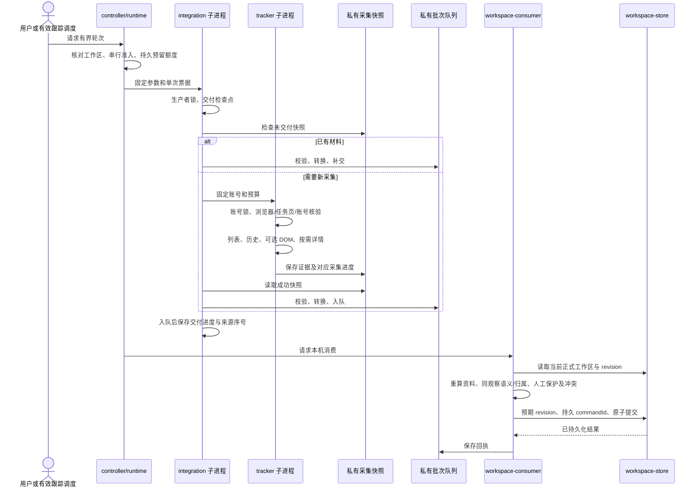

# BOSS 只读采集与岗位更新：实现说明

本文沿[设计流程](DESIGN.md#完整流程)说明代码职责、数据所有者和安全交付机制。当前业务条件由[设计说明](DESIGN.md)维护，命令及故障处理见[使用与排障](OPERATIONS.md)；正式工作区、备份、同步与恢复的共用契约由[数据与恢复](../DATA_AND_RECOVERY.md)维护。

核对基线：`3ce4728`，应用 0.10.22、规则 v17。`dist/` 是作者维护的源码，不是需要重新生成的构建输出。本文不表示[待实施重构](../ARCHITECTURE_REFACTOR_PLAN.md)已经完成。

## 模块与调用顺序

入口是 [`boss-control.mjs`](../../scripts/boss-control.mjs) 与受保护的[本机控制 API](../../scripts/boss-controller-api.mjs)。[`boss-controller.mjs`](../../scripts/boss-controller.mjs) 调用 [`boss-runtime.mjs`](../../scripts/boss-runtime.mjs)，再启动固定 [`boss-integration.mjs`](../../scripts/boss-integration.mjs)，后者需要新采集时才启动 [`tracker.mjs`](../../collector/boss/tracker.mjs)。因此 integration 在采集前后都参与，快照不由网页转换或消费。

服务还可独立周期消费本机队列和重新判断 waiting/review；这不授予平台读取权限。controller/runtime 与采集器的身份检查互补：前者管理授权和额度，后者检查实际浏览器、目标和账号。

## 状态与数据所有者

| 状态                                 | 唯一职责及所有者                                                                        | 持久位置或交付物                                                                    |
| ------------------------------------ | --------------------------------------------------------------------------------------- | ----------------------------------------------------------------------------------- |
| 跟踪生命周期、轮次预留和滚动预算     | `boss-runtime`，controller 负责固定入口、正式工作区准入和票据                           | `.local/boss-integration/tracking.json`                                             |
| 浏览器与任务页绑定                   | `cdp-browser` 检查实例、target、URL；`extract` 核验账号；`storage` 保存连接元数据       | 采集账号目录的连接文件与专用 profile                                                |
| 已取得的列表、岗位证据及消息观察     | `model-v2 / resume-history` 维护采集模型，`storage` 保存不可变快照                      | `.local/boss-collector/<账号>/`                                                     |
| 历史任务、水位、分页、详情退避及轮转 | `change-history` 计算任务；`runtime-state` 保存；tracker 串联阶段                       | `.runtime-v3.json`，读取旧 runtime v1/v2 并保留旧文件                               |
| 可恢复的历史页材料                   | `runtime-state` 安全读写；由 `history-phase` 编排；变化任务提交由 `history-commit` 协调 | `.change-checkpoint-v1.json`、`.resume-checkpoint-v1.json`；路径 v1 不表示内容仍 v1 |
| 标准批次、交付进度、生产者暂停       | integration/conversion/inbox 分别负责转换、入队及配套进度                               | `.local/boss-integration/` 的 inbox、runs、control 与交付检查点                     |
| 事实及应用决定                       | `workspace-consumer` 准备当前工作区候选，纯规则判断；`workspace-store` 唯一提交         | `.local/workspace/` 不可变提交与原子 HEAD                                           |
| 批次回执                             | inbox 在正式提交之后记录，由 consumer 核对                                              | `.local/boss-integration/receipts/`                                                 |
| 页面正式数据                         | 页面读取服务，IndexedDB 只作本机读取缓存                                                | 服务失联停止正式写入，保留缓存与草稿                                                |

完成标记不能互相代替：保存快照是取得材料，入队是交付材料，正式提交是保存业务结果，回执是处理记录。生产者暂停、跟踪授权和业务等待也分别管理。私有目录及文件使用 `0700 / 0600`，profile、原始快照和真实资料不进入源码或 `dist/`。

## 身份与字段契约

### 平台字段到标准观察

| 字段或材料                    | 来源与约束                                                                                           | 后续用途                                                                             |
| ----------------------------- | ---------------------------------------------------------------------------------------------------- | ------------------------------------------------------------------------------------ |
| `accountNamespace`            | 由核验后的本人账号 ID 计算；配置中的账号标签仅选私有目录                                             | 账号隔离及工作区绑定，不用标签假定账号正确                                           |
| 会话 key                      | 稳定哈希包含平台、namespace、`friendId / friendSource`，同时核对 `uniqueId` 对应关系                 | 姓名、公司、招聘人职务是可变属性，不参与正式去重；缺平台 ID 不回退姓名主键           |
| `latestMessageId`、摘要及回执 | 列表字段独立提取；可见 DOM 标签与样式共同支持 read/delivered                                         | 指纹、事实类型和展示，不把摘要变化称为新消息或用回执证明简历发送                     |
| `encryptJobId`、规范链接      | 共用 [`boss-job-url.js`](../../dist/boss-job-url.js)；ID 为 1–300 位字母、数字、`_`、`-`、`~`        | 校验 `https://www.zhipin.com/job_detail/<ID>.html`，去查询及片段比较；用户原链接保留 |
| 岗位名称与公司                | 列表实际 `jobName` 或经 [`boss-detail-title.js`](../../dist/boss-detail-title.js) 解析的完整详情标题 | 详情证据保存岗位 ID、规范 URL、标题及独立 `observedAt`；招聘人职务不是岗位名         |
| 简历观察                      | `resume-history` 只提取固定字段、类型、身份和时间，不保存完整响应                                    | 使用共用语义分类器；普通卡片和明确确认各自保存                                       |
| `attribution`                 | 分开保留请求目标、联系人响应和消息自身参与者/岗位身份                                                | 消费时重新核对，不将请求参数或候选复制视为响应证明                                   |
| `resumeEvidence`              | 最小语义字段、固定文案或动作判别；附件名脱敏占位                                                     | 消费独立重验；不保存原始扩展串、正文、简历或凭据                                     |
| 观察和日期                    | 列表 `capturedAt`、岗位 `observedAt`、消息平台时间各自保留                                           | 日期投影取原快照，不按交付当天重算；列表外详情不补造日期                             |

归属依据 v1 固定字段为 `version / source / accountNamespace / conversationKey / messageId / requestedBossId / responseFriendId / responseFriendSource / responseBossId / selfId / senderId / recipientId / messageJobId`；未知字段拒绝，`source` 区分 history、dom、list，缺值明确为 null。DOM 系统消息独立来源是 `dom_chat_status_message_v1`，必须同时有稳定消息 ID 和平台时间。

原始平台字段解析集中在采集适配器；批次结构、枚举和校验由 [`boss-batch.js`](../../dist/boss-batch.js) 共用，磁盘读写与安全检查仍由服务 [`boss-inbox.mjs`](../../scripts/boss-inbox.mjs) 负责。API 不接受任意执行路径或请求；采集器固定在仓库内，旧 `trackerRoot` 配置不决定源码位置。

### 稳定事实、事件和应用身份

[`boss-conversion.mjs`](../../scripts/boss-conversion.mjs) 按既有规范序列化和哈希生成批次及事件；兼容首批、确认日期投影由 [`boss-legacy-import.mjs`](../../scripts/boss-legacy-import.mjs) 保留。定点交付在事件映射前筛选观察 ID，缺省转换不变；不修改原始观察以补齐资料。

[`source-identity.js`](../../dist/source-identity.js) 以平台、账号、会话、稳定消息 ID 和事实类型生成事实 ID，应用 ID 从事实 ID 派生。同消息的普通、送达、已读或简历类别可有不同事实；[`boss-observations.js`](../../dist/boss-observations.js) 仅把它们汇总展示。无稳定消息身份保留采集问题，不制造事实或应用 ID。进程内身份计算缓存只复用纯计算，调用方仍校验记录，不信任传入事实 ID。

旧 v1 的姓名加公司映射仅用于双方唯一的迁移推定，岗位冲突或任一侧重复进入 quarantine；不能替代现行身份链。重复迁移及导入幂等，歧义保留，不随意配对或静默丢弃。

### 岗位证据的三种用途

[`job-evidence.mjs`](../../collector/boss/job-evidence.mjs) 只在调用方已选定的会话关联上匹配精确岗位和规范链接，返回证据、名称来源、矛盾和确认结果；关联选择、列表外资格、输出格式及哈希由 adapter 负责。

| 投影              | 当前语义                                                                                                                               | 不负责什么                                                           |
| ----------------- | -------------------------------------------------------------------------------------------------------------------------------------- | -------------------------------------------------------------------- |
| `collector`       | 详情优先于已加载 jobName，再到旧命名资料；用 NFC、空白归一比较详情矛盾；无可选资料返回 null                                            | 不决定正式岗位更新或简历归属                                         |
| `detail_delivery` | 保留详情优先和现代矛盾判断，允许原列表名称缺省；同岗一致详情可交付                                                                     | 列表外记录须另行满足有效身份、唯一当前关联、原观察时间及一致详情资格 |
| `legacy_identity` | 冻结旧排序：loaded jobName 优先于详情，再到旧命名资料；同等级按时间。详情用原始文字比较，公司仅 trim 后与会话公司过滤，保留旧 fallback | 只保证旧事件/事实投影输入与历史 ID；不是当前业务采用资料的权威规则   |

确认记录只匹配精确会话 key、岗位 ID、规范链接和 `confirmed_user`，不能传播到同名公司、别的岗位或招聘者。现代资料可采用详情用人公司与不同招聘方；旧身份投影保留原筛选不意味着当前业务仍要求两公司同名。采集 `status` 和 `jobs.md` 共用 model resolver，正式资料应用由 [`boss-job-materials.js`](../../dist/boss-job-materials.js) 按当前工作区判断。

### 正式规则与字段所有权

[`resume-rules.js`](../../dist/resume-rules.js) 定义唯一简历枚举、含义及转换；[`boss-attribution.js`](../../dist/boss-attribution.js) 构建临时上下文并返回 verified/insufficient/conflict；`boss-job-materials` 返回普通资料的目标、来源、有效应用输入、允许字段和 reuseOnly。当前具体条件统一在[设计说明](DESIGN.md#归属判断)维护。

[`boss-integration.js`](../../dist/boss-integration.js) 用同一观察完整语义与归属决定应用；[`source-ledger.js`](../../dist/source-ledger.js) 分开保留不可变来源与应用决定。自动字段须属于绑定 `autoFields`，且当前值等于对应 `lastAuto*` 才允许自动维护；用户修改或明确清空退出该字段自动所有权。稳定重评不反复生成无变化提交，旧身份投影不会越过当前规则。

## 私有格式与兼容

正式共享数据与工作区版本不同于采集格式；完整版本表及迁移规则见[共享存储契约](../DATA_AND_RECOVERY.md#版本与两种存储模式)。本节维护采集材料自身的兼容门槛。

| 内容               | 当前写入                                                                      | 兼容读取及约束                                                               |
| ------------------ | ----------------------------------------------------------------------------- | ---------------------------------------------------------------------------- |
| 采集快照与标准批次 | v8                                                                            | 读取旧 v1–v7，成功保存另建不可变快照，不覆盖原件                             |
| 历史检查点内容     | v6                                                                            | 读取旧 v1–v5，路径仍沿用两个 checkpoint-v1 文件名                            |
| DOM 检查点内容     | v2                                                                            | 读取旧 v1，路径仍为 `.dom-supplement-checkpoint-v1.json`；未知切换不自动重放 |
| 采集运行状态       | `.runtime-v3.json` / v3                                                       | 读取旧 v1/v2，保留旧文件、公平游标、详情退避和连接重试状态                   |
| 语义依据 v1        | 类型、白名单字段、固定文字                                                    | `field=none` 和旧 type4 仅观察；旧 type1 文字不能提升为发送                  |
| 语义依据 v2        | v1 字段加 bizType、bodyType、templateId、hyperLinkType                        | 至少快照/批次 v6，检查点 v4                                                  |
| 语义依据 v3        | version、messageType、field、text、bodyType、templateId、actionAid、annexType | 至少快照/批次 v7，检查点 v5；field 为 body.action，发送文案固定              |
| 语义依据 v4        | v3 动作字段加 extensionFormat、platformContract                               | 至少快照/批次 v8，检查点 v6；opaque_string、固定已核实契约、annexType=null   |

校验每层字段白名单及版本，旧容器不得夹带新依据，未知字段、未知契约和未来版本拒绝写入。旧无依据观察升级只补 null，不改变身份、类别或自动确认发送；旧卡片及已存档 no_effect 不因格式升级取得可信地位。

语义和归属依据只随私有快照、批次、检查点保存，正式共享来源事件不新增其原始字段。服务重放合法已保存依据按原核实契约判断，不要求访问当前页面，也不因当前版本变化回退历史。回退服务应先保留全部私有原件；旧程序不认识格式时停止，不能删字段、降版保存或删除检查点强制重读。

[`platform-reference.mjs`](../../collector/boss/platform-reference.mjs) 保存已核实 app/chat URL、build、asset、原始字节 SHA256 与字节数，当前参考为 `v5550 / 4d4a6ac8`。正常读历史前只读已加载脚本 URL，并复用前后账号和原绑定目标守卫；无目标、完成检查点回放不增加历史请求或版本读取，原账号预检保留。结果的 `reviewed_url / contentVerified=false` 不证明本轮字节相同；显式字节比较与源码核实是另一项操作，不自动下载或执行。完整第三方源码仅保存在忽略私有目录。

## 交付与提交顺序

### 采集阶段

变化驱动历史由 [`history-commit.mjs`](../../collector/boss/history-commit.mjs) 执行：每页先保存私有检查点，随后保存含观察和未支持原因的证据快照，再保存任务进度，最后删除检查点。任一步失败保留可重放材料。仅有 unresolved 原因的检查点也须先保存原因；续页继承并去重旧原因，普通消息水位不表示发送确认。

两种历史策略由 [`history-phase.mjs`](../../collector/boss/history-phase.mjs) 的 `collectHistory` 共用身份核验、已加载平台版本读取、请求计量和恢复。变化驱动仍逐任务提交；公平回填的 `.resume-checkpoint-v1.json` 先恢复已有证据，未完成页在具备额度时继续，入口成功保存 JSON 与 Markdown 后调用 `settleSaved` 结算检查点。正常轮次的旧材料恢复、列表任务准备和水位更新也由该模块负责；零历史额度仍完成列表准备，独立扫描保持原公平游标语义。详情由独立命令和整轮入口分别编排选择、读取、并入资料、退避和游标保存，当前未集中进同一 history-commit。

页面补采在目标动作前先保存已校验的输入 JSON 快照，确保本轮新会话的恢复上下文已经落盘；此前保存失败不执行目标动作。取得结果后先保存 v2 `result_ready` 检查点，再保存含规范观察的 JSON 与岗位 Markdown，随后幂等保存 completed/cursor，最后删除检查点。检查点只包含原账号与目标、规范观察、白名单依据、不足原因和覆盖统计，不包含原始响应或正文。任一步失败保留可本机恢复材料；保存失败仍报告本轮实际切换用量。旧 v1 selected 等待新的正常授权，switch_issued 缺结果保持未知，不自动重放。生产默认关闭。

独立详情补查与正常采集共用最终故障分类：最终账号核验失败优先返回 `account` 及原安全错误码，保留已保存资料、实际导航量和清理结果，不把账号失效归入单岗位退避。测试可注入身份核验函数，生产默认仍执行固定的账号与页面检查。

`tracker.saveEnvelope` 先保存 JSON，再导出私有 Markdown。导出失败保留已保存 JSON，返回固定 `JOB_EXPORT_FAILED` 或既有安全错误码，不输出原异常。成功快照、清单导出和轮次完成分别确认。请求发出后，后续证据/进度/导出失败仍保留实际用量；检查点纯本机恢复不增加请求用量。

### 入队与正式消费

integration 先持有生产者锁，再查交付进度和未导出快照；材料校验、归属诊断、确定性批次、原子入队成功后才保存交付检查点及来源序号。转换摘要绑定当前版本的证据，稳定事件和事实身份保持。普通轮次与 `recover-saved` 的外围结果整理目前仍分开。

[`workspace-consumer.mjs`](../../scripts/workspace-consumer.mjs) 使用当前工作区与整批准入材料重新构建上下文，处理岗位资料、同观察语义及归属、人工决定和局部同步冲突；[唯一工作区写者](../../scripts/workspace-store.mjs) 按预期 revision 和持久 commandId 原子提交，然后消费方确认回执。没有业务变化不产生重复提交；回执失败不能把已持久化业务结果报成未提交并重复应用。

诊断及关键保存失败不确认相关进度或交付。采集诊断只反映当时可见材料，消费诊断包含当前工作区和批次。归属诊断去重，只保留字段存在情况、身份摘要、判定和固定原因；一般故障保留运行/批次 ID、阶段、数量、完成/剩余项与安全清理结果，不保存私人正文、简历、原始扩展、凭据或全量页面内存。

恢复后的当前事件、事实、应用及目标必须存在并匹配；旧磁盘回执不是存在证明。缺口要求当前 revision 下明确核对固定批次，不能无条件重灌队列、复活删除岗位或扩大人工决定。正式原子写入、冲突重基和恢复基元只在[数据与恢复](../DATA_AND_RECOVERY.md#本机不可变提交)维护。

## 并发预算与重试

### 串行与内部票据

runtime 串行平台轮次，生命周期命令有调用顺序屏障。start/resume/recover-page 在 CDP 操作前等前序轮次收尾；pause 立即阻止后续调度，在途动作安全收尾；stop 等前序在途结束。晚到结果不能覆盖更新的暂停/停止，重复在途触发复用同一轮。

平台动作必须通过 [`boss-internal-auth.mjs`](../../scripts/boss-internal-auth.mjs) 的短时票据，精确绑定 collect-cycle、历史/DOM/详情额度与 change/backfill 模式，原子消费一次。controller 固定源码及配置；旧直连脚本不能绕过统一控制。runtime 保存预留及实际结算，采集器只报告实际用量，不自行创建每小时预算。

账号采集锁、integration 生产者锁和正式工作区写者锁各保护不同资源；重启不清锁对应预算，也不恢复跟踪授权。持久动作上限和结算规则在[设计说明](DESIGN.md#动作预算)唯一维护，不因本地恢复和重试另设额度。

### 请求、连接和本机命令

| 类别                        | 当前重试与恢复方式                                                                                                                |
| --------------------------- | --------------------------------------------------------------------------------------------------------------------------------- |
| 历史平台请求                | 页面内 15 秒主动超时，CDP 外层 20 秒停止等待；已发而结果未知按一次保守计数，不在调试通道重连中重放，保存页码等下一轮              |
| 无平台副作用的 CDP 传输中断 | 持久 2、10、30 秒，最多三次重连；计数及下次时间跨轮次保留，身份/页面错误不属于传输重试                                            |
| 创建、导航、切换或关闭      | 不自动重放结果未知的副作用命令，先核对目标及所有权                                                                                |
| 列表未就绪                  | 同一操作最多 10 秒、20 次间隔 500 毫秒的只读等待；每次再核验实例、任务和 URL，账号错误直接失败；单次 I/O 另受原超时，总耗时可更长 |
| 完成历史检查点              | 纯本机重放不需要新请求；预算豁免只适用该任务，后续任务仍须有足够额度                                                              |
| 本机服务变更命令            | 使用预期 revision 和一个持久 commandId；丢失响应仅重发原请求，冲突后重新核对，不改算请求自动重放                                  |

传输重连不改变登录、目标或账号守卫，也不扩大页面动作范围。详情级与账号级失败的区别、退避和技术隔离条件在[失败行为](DESIGN.md#失败行为与限制)维护。

## 代码阅读与测试

先沿流程阅读，再看具体底层文件：

1. controller/runtime → integration：授权、单次预算票据、恢复优先及本机消费入口。
2. tracker 的 main/run → extract → model-v2：列表怎样变成采集状态。
3. change-history → resume-history → history-commit/runtime-state/storage：选择谁、取得什么、何时确认进度。
4. detail-enrich → job-evidence → model-v2.applyDetailEvidenceV2：详情取得、证据选择及并入。
5. boss-conversion/boss-batch/boss-inbox → workspace-consumer：转换与入队。
6. resume-rules/boss-attribution/boss-job-materials → boss-integration/source-ledger → workspace-store：正式判定与持久提交。

### 采集器文件职责

#### 1. 主入口

| 文件                                            | 负责什么                                                                                                     | 主要关系                                                                                                     |
| ----------------------------------------------- | ------------------------------------------------------------------------------------------------------------ | ------------------------------------------------------------------------------------------------------------ |
| [tracker.mjs](../../collector/boss/tracker.mjs) | 解析命令参数；安排列表、历史、页面补采和详情阶段；选择补录目标，汇总用量、故障和本机状态；保存快照与导出清单 | 调用下面各组模块。`run` 执行控制层分配的一轮任务，自身不安装周期调度；补录与正常历史的部分外围编排仍各自存在 |

建议先看 `main` 的 `run` 分支，再按调用进入具体文件。

#### 2. 浏览器连接与读取

| 文件                                                    | 负责什么                                                                                                                             | 主要关系                                                                                                                                             |
| ------------------------------------------------------- | ------------------------------------------------------------------------------------------------------------------------------------ | ---------------------------------------------------------------------------------------------------------------------------------------------------- |
| [cdp-browser.mjs](../../collector/boss/cdp-browser.mjs) | 通过 Chrome 调试协议连接专用浏览器；绑定、核验任务页，执行固定读取表达式；等待列表就绪；提供受控详情标签的创建、导航、读取和清理能力 | `tracker` 调用 `start / resume / capture / evaluateBound`；`detail-enrich` 通过它提供的详情页面操作函数（adapter）读取页面                           |
| [guard.mjs](../../collector/boss/guard.mjs)             | 提供预期聊天网址与网址检查；保留旧原生标签观察、文本读取及诊断辅助函数                                                               | 当前主流程使用 `expectedUrl / isExpectedUrl`；账号及浏览器实例的完整核验由 `cdp-browser` 配合 `extract` 完成。其余旧原生辅助函数未发现当前运行调用者 |
| [paths.mjs](../../collector/boss/paths.mjs)             | 计算私有数据根目录、账号目录和浏览器 profile 路径，校验账号标签与路径输入                                                            | `tracker / export-jobs` 使用账号目录；`cdp-browser` 使用 profile 目录。实际写文件由存储模块负责                                                      |

`start` 和显式 `recover-page` 可以按既有规则建立任务页。日常读取复用绑定的浏览器实例与任务页，账号或目标变化时停止；不能由正常轮次随意重建页面。

#### 3. 列表与消息

| 文件                                                                  | 负责什么                                                                                                                            | 主要关系                                                                                                                                  |
| --------------------------------------------------------------------- | ----------------------------------------------------------------------------------------------------------------------------------- | ----------------------------------------------------------------------------------------------------------------------------------------- |
| [extract.mjs](../../collector/boss/extract.mjs)                       | 定义账号与列表读取脚本；读取已加载 Vue 列表数据，补充已渲染行的时间/回执；转换为标准列表快照，计算账号隔离标识（namespace）与会话键 | 由 `cdp-browser` 执行，结果交给 `tracker / model-v2`；回执解析复用 `receipt`                                                              |
| [receipt.mjs](../../collector/boss/receipt.mjs)                       | 从可见标签和样式解析消息的 `read / delivered / unknown`，并汇总数量                                                                 | 被 `extract` 的页面脚本及 `tracker` 汇总调用；只表示消息回执，不判断简历是否发送                                                          |
| [change-history.mjs](../../collector/boss/change-history.mjs)         | 根据最新消息 ID、摘要和岗位 ID 的变化安排历史任务；计算待执行任务、成功消息位置、分页进度及失败等待                                 | 是纯状态计算，不发请求、不写文件。`tracker / history-commit` 调用它，`runtime-state` 保存结果                                             |
| [resume-history.mjs](../../collector/boss/resume-history.mjs)         | 生成联系人/历史分页的只读请求脚本；串行读取消息，限制请求与页数；转换、去重并合并简历观察及无法识别的原因                           | `history-phase` 两种策略共用 `runResumeHistoryRequests`；`history-commit / dom-supplement` 复用观察转换。消息含义来自目录外的共用简历规则 |
| [platform-reference.mjs](../../collector/boss/platform-reference.mjs) | 保存已核实的公开平台版本参考；读取当前已加载脚本 URL，判断新的不透明动作扩展是否适用；提供显式字节指纹比较函数                      | `history-phase` 在实际历史读取前调用，再把契约传给 `resume-history`。URL 匹配不证明本轮源码字节相同；它不自动下载源码                     |
| [dom-supplement.mjs](../../collector/boss/dom-supplement.mjs)         | 在特定历史读取不足时，从聊天页面补读白名单系统状态；管理独立的人工验收策略、轮转进度和切换检查点                                    | 由 `tracker` 可选调用，转换复用 `resume-history`。须有账号绑定验收策略和明确零未读依据；生产默认关闭，选择器仍待人工验收                  |

[`history-phase.mjs`](../../collector/boss/history-phase.mjs) 是历史阶段入口：`collectHistory` 返回材料、状态候选、统计和用量；`settleSaved` 只结算已完整保存的公平补录材料。运行入口合并最新 CDP 重连状态后保存运行进度，阶段不拥有跟踪授权或小时预算。

**这里的区别：** `change-history` 决定读谁，`resume-history` 执行历史读取，`receipt` 解释列表回执。[简历发送含义](DESIGN.md#简历识别与联动)和[岗位归属](DESIGN.md#归属判断)仍需各自核对，`strong` 只是采集侧的分类标签，不能代替服务应用判定。

#### 4. 采集数据与岗位资料

| 文件                                                        | 负责什么                                                                                                                                       | 主要关系                                                                                                              |
| ----------------------------------------------------------- | ---------------------------------------------------------------------------------------------------------------------------------------------- | --------------------------------------------------------------------------------------------------------------------- |
| [model-v2.mjs](../../collector/boss/model-v2.mjs)           | 校验和升级采集数据；比较当前列表与旧快照；维护长期会话、岗位关联、资料证据、候选与已有确认；迁移旧资料；并入详情结果，生成岗位解析行和待补目标 | 当前 `tracker` 使用的采集模型；依赖 `job-evidence` 及目录外的链接、标题和证据格式校验规则。它不提交工作台正式岗位     |
| [job-evidence.mjs](../../collector/boss/job-evidence.mjs)   | 在已选会话关联上匹配岗位 ID/规范链接，排序资料证据、核对矛盾及确认记录，返回选用资料与来源                                                     | 被 `model-v2` 和目录外 `scripts/boss-conversion.mjs` 共用；显式保留采集展示、详情交付、旧身份映射三种用途的差异       |
| [detail-enrich.mjs](../../collector/boss/detail-enrich.mjs) | 分组待补岗位，复用已有证据；通过传入的页面操作函数串行读取稳定的详情标题，取得岗位名/用人公司及独立观察时间，返回完成与失败结果                | 页面操作由 `cdp-browser` 提供，结果由 `model-v2.applyDetailEvidenceV2` 并入采集模型；范围、延迟和外层额度由调用者传入 |
| [compare.mjs](../../collector/boss/compare.mjs)             | 校验并比较旧 v1 列表状态，维护旧格式的差异与记录                                                                                               | 用于旧导出兼容及测试；当前平台身份主链路使用 `model-v2.compareLoadedSnapshotsV2`                                      |
| [job.mjs](../../collector/boss/job.mjs)                     | 旧格式岗位候选的规范化、选择及数量汇总                                                                                                         | `tracker` 用 `jobCounts` 汇总 v1 状态；候选选择函数当前主要由旧格式测试使用，不是现行详情证据判断入口                 |

`model-v2.mjs` 中的 **v2 是历史文件名**，当前正常升级/写入的采集容器是 **v8**；它与工作台共享数据版本是两件事。当前版本表见[数据与恢复](../DATA_AND_RECOVERY.md#版本与两种存储模式)。

详情的用人公司可以与聊天中的招聘方不同；精确岗位身份一致时，这个名称差异不单独构成冲突。详情证据选择与工作台的普通资料应用仍是两个步骤，具体规则见[岗位资料与平台状态](DESIGN.md#岗位资料与平台状态)。

#### 5. 保存、恢复与导出

| 文件                                                          | 负责什么                                                                                                      | 主要关系                                                                                                                  |
| ------------------------------------------------------------- | ------------------------------------------------------------------------------------------------------------- | ------------------------------------------------------------------------------------------------------------------------- |
| [storage.mjs](../../collector/boss/storage.mjs)               | 读取最近采集快照；保存/移除连接元数据；建立账号采集锁；先保存诊断，再以临时文件替换保存不可变快照             | 由 `tracker` 调用；保存的是私有采集材料，不是正式工作区提交                                                               |
| [runtime-state.mjs](../../collector/boss/runtime-state.mjs)   | 校验、读写本机运行状态和两类历史检查点；保存补录/详情游标、历史任务、详情失败等待、CDP 有限重连及最近轮次结果 | `tracker / history-commit` 使用；历史逻辑状态复用 `change-history`。不负责服务跟踪授权或滚动小时预算                      |
| [history-commit.mjs](../../collector/boss/history-commit.mjs) | 协调变化驱动历史的恢复与提交：先保存材料，再保存任务进度，最后移除检查点                                      | 通过注入的保存函数和 `runtime-state` 操作；复用 `change-history / resume-history`。当前未统一覆盖公平补录、详情或页面补采 |
| [export-jobs.mjs](../../collector/boss/export-jobs.mjs)       | 把采集模型整理成私有 `jobs.md` 清单，安全写入 Markdown；兼容旧采集格式                                        | 当前格式通过 `model-v2` 解析岗位，与 `status` 共用解析结果；旧格式分支使用 `compare`                                      |

`tracker.saveEnvelope` 先保存 JSON，再导出 Markdown。导出失败时，已保存的快照保留，可继续本机恢复。

页面补采有独立的结果检查点与提交流程；`recoverDomSupplement` 只重放已取得的规范结果，不读取策略或访问平台。`recover-saved` 在账号采集锁内完成这部分恢复，再扫描交付新快照。它不把 DOM 完成回执当作业务归属依据。

### 容易混淆的文件

| 两者                                     | 区别                                                   |
| ---------------------------------------- | ------------------------------------------------------ |
| change-history / resume-history          | 任务选择与纯进度计算；真正读取历史并转换观察           |
| history-commit / runtime-state / storage | 变化驱动历史提交顺序；进度和检查点文件；快照和连接文件 |
| detail-enrich / job-evidence / model-v2  | 取得详情；判断适用证据；将资料并入采集状态             |
| compare / model-v2                       | 旧 v1 比较兼容；当前平台身份模型                       |
| runtime-state / boss-runtime             | 采集游标、退避和检查点；授权生命周期和持久预算         |
| storage / workspace-store                | 私有来源快照；正式工作区唯一写者                       |

### 合成测试位置

以下均为合成数据、模拟执行器或临时目录测试。即使文件名包含 `cdp-browser` 或 DOM，也不代表测试启动真实浏览器；真实验收由用户负责。

| 测试文件                                                                        | 主要检查什么                                                                          |
| ------------------------------------------------------------------------------- | ------------------------------------------------------------------------------------- |
| [tracker.test.mjs](../../collector/boss/tracker.test.mjs)                       | 参数、目标选择和汇总；两种历史入口、请求用量、检查点恢复、平台版本检查及保存/导出失败 |
| [cdp-browser.test.mjs](../../collector/boss/cdp-browser.test.mjs)               | 绑定与任务页复用、列表就绪等待、账号/浏览器/目标变化、受控详情标签操作                |
| [extract.test.mjs](../../collector/boss/extract.test.mjs)                       | 已加载列表、稳定会话身份、回执和覆盖统计，异常字段与页面结构                          |
| [receipt.test.mjs](../../collector/boss/receipt.test.mjs)                       | 已读/送达标签与样式匹配；缺失、隐藏或矛盾保持未知                                     |
| [change-history.test.mjs](../../collector/boss/change-history.test.mjs)         | 初始化与变化排队、旧任务指纹、失败等待/隔离和其他任务继续                             |
| [resume-history.test.mjs](../../collector/boss/resume-history.test.mjs)         | 只读请求、消息分类和身份、分页/用量/检查点、版本门槛、稳定观察和脱敏                  |
| [history-commit.test.mjs](../../collector/boss/history-commit.test.mjs)         | 保存材料、进度、移除检查点各阶段失败；仅有未支持原因及目标变化时的恢复                |
| [dom-supplement.test.mjs](../../collector/boss/dom-supplement.test.mjs)         | 人工策略、零未读、预算、独立来源、切换未知不重试及私有状态保存                        |
| [platform-reference.test.mjs](../../collector/boss/platform-reference.test.mjs) | 公开脚本 URL/版本匹配、账号检查、只读元数据及显式字节指纹                             |
| [model-v2.test.mjs](../../collector/boss/model-v2.test.mjs)                     | 会话/岗位关联、旧格式迁移、资料证据、候选/确认、详情合并及容器校验                    |
| [detail-enrich.test.mjs](../../collector/boss/detail-enrich.test.mjs)           | 标题稳定、详情证据复用、资料提取、失败范围和自有标签清理                              |
| [job.test.mjs](../../collector/boss/job.test.mjs)                               | 旧岗位候选的规范化、选择与数量                                                        |
| [job-review.test.mjs](../../collector/boss/job-review.test.mjs)                 | 旧 v1 链接确认的校验、持久保留和精确作用范围                                          |
| [compare.test.mjs](../../collector/boss/compare.test.mjs)                       | 旧格式列表差异、缺项/重复、消息/回执/岗位变化和无效数据                               |
| [runtime-state.test.mjs](../../collector/boss/runtime-state.test.mjs)           | 轮转、退避/隔离、有限重连、私有检查点、版本门槛及旧状态兼容                           |
| [storage.test.mjs](../../collector/boss/storage.test.mjs)                       | 不可变快照、采集锁、连接元数据、权限与异常保存                                        |
| [export-jobs.test.mjs](../../collector/boss/export-jobs.test.mjs)               | 当前/旧格式清单输出、候选与回执展示、私有 Markdown 写入                               |

`guard.mjs`、`paths.mjs`、`job-evidence.mjs` 没有同目录的同名测试文件；不能据文件名直接判断功能是否有间接测试。`job-evidence` 的跨层对照测试在 [`test/boss-job-evidence.test.mjs`](../../test/boss-job-evidence.test.mjs)，覆盖三种用途、各类批次和稳定身份；模型、详情与转换测试也会使用该规则。

### 跨模块验收

| 测试入口                                                                                                                                                            | 覆盖的契约                                                       |
| ------------------------------------------------------------------------------------------------------------------------------------------------------------------- | ---------------------------------------------------------------- |
| [boss-job-evidence](../../test/boss-job-evidence.test.mjs)、[保留详情交付](../../test/boss-retained-detail-delivery.test.mjs)                                       | 三种投影差异、详情优先、等价文字、旧 ID 与列表外交付资格         |
| [简历语义](../../test/boss-resume-semantics.test.mjs)、[动作依据](../../test/boss-action-evidence.test.mjs)、[不透明链路](../../test/boss-opaque-pipeline.test.mjs) | 严格结构、普通文字/卡片/作品集拒绝、私有版本门槛、同观察消费重验 |
| [归属](../../test/boss-attribution.test.mjs)、[稳定重评](../../test/boss-stable-attribution.test.mjs)                                                               | 账号隔离、同批及跨批矛盾、独立候选、事件顺序及无变化重评         |
| [运行预算](../../test/boss-runtime.test.mjs)、[控制器](../../test/boss-controller.test.mjs)、[内部票据](../../test/boss-internal-auth.test.mjs)                     | 串行生命周期、持久计量、有限失败及精确一次准入                   |
| [正式消费](../../test/boss-consumer.test.mjs)、[工作区消费](../../test/workspace-consumer.test.mjs)、[本机命令](../../test/local-workspace.test.mjs)                | 唯一提交、回执后失败、恢复缺口、冲突、重放与缓存失败             |
| [人工资料](../../test/boss-manual-job-details.test.mjs)、[纠错恢复](../../test/boss-resume-correction-restore.test.mjs)                                             | 持续人工决定、删除重复目标、字段保护及恢复不扩大纠错范围         |

上述测试使用合成材料、模拟执行器或临时目录；文件名包含 CDP/DOM 不表示启动真实浏览器。代理运行相关非浏览器测试、完整 pnpm test、pnpm check 和 pnpm format:check；不运行包含浏览器测试的 pnpm verify。真实原始字段与页面验收由用户确认，交付步骤见[人工验收](OPERATIONS.md#人工验收)。
